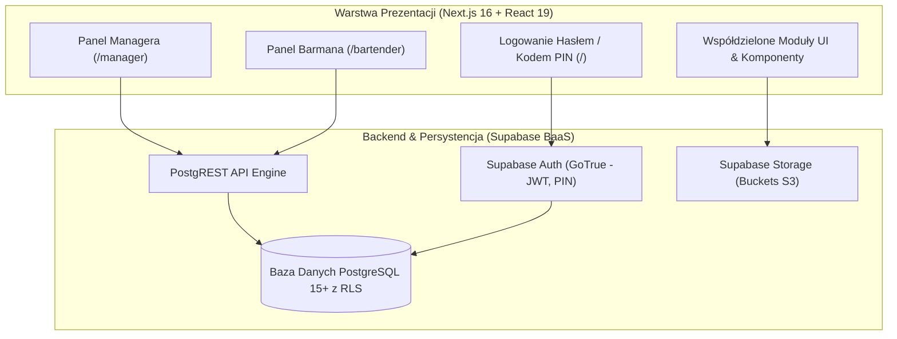
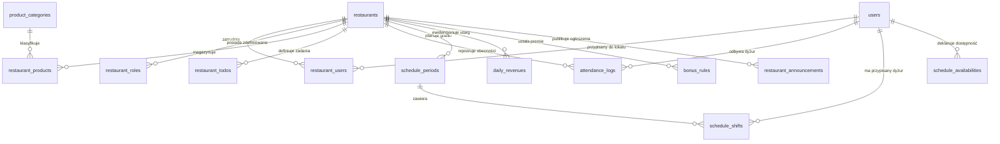
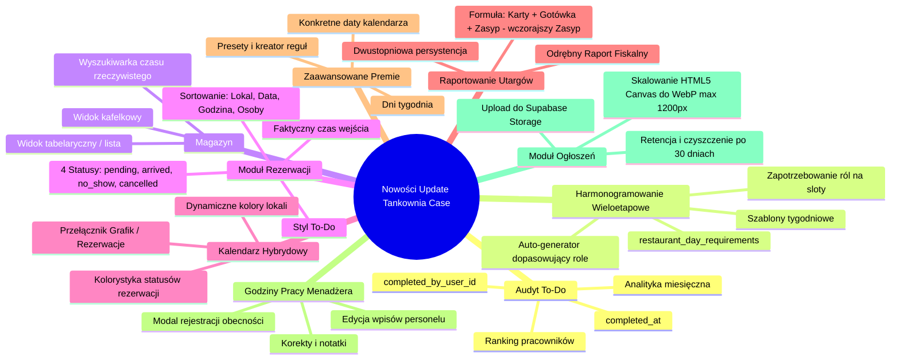
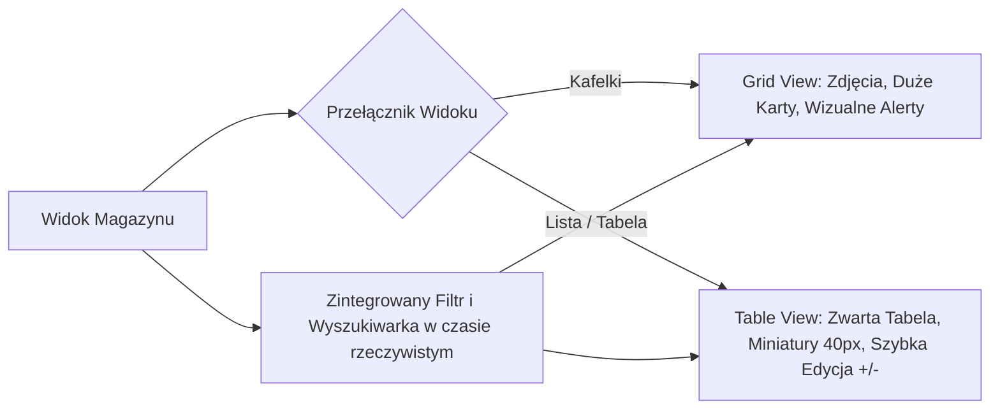
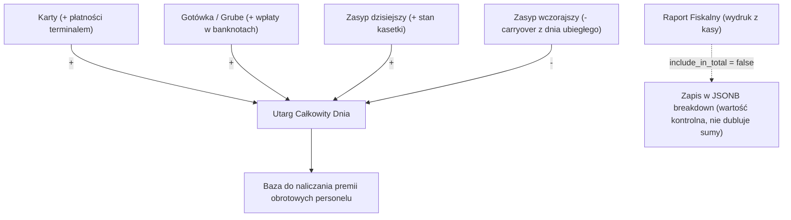
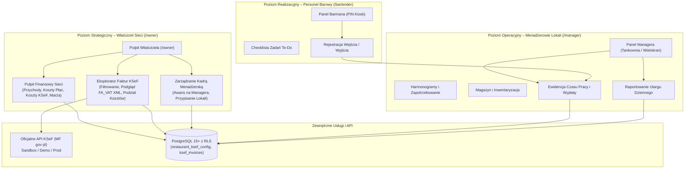

# RAPORT ARCHITEKTURY I HISTORIA ZMIAN SYSTEMU GASTRO APP
## Od Wersji Bazowej (v1) przez Aktualizację Tankownia (v2.0.0) do Gałęzi `feature/update-owner`

---

### Metryka Dokumentu
* **Nazwa Systemu:** Gastro App – Zintegrowana Platforma Zarządzania Gastronomią i Siecią Lokali (m.in. Wielokran, Tankownia)
* **Katalog Projektu:** `gastro-app`
* **Główna Gałąź Wdrożeniowa:** `feature/update-owner` (poprzednio `feature/update-tankownia-case`)
* **Stos Technologiczny:** Next.js (App Router, React 19), TypeScript, Tailwind CSS, Supabase (PostgreSQL 15+, GoTrue Auth, RLS, Storage)
* **Status:** Oficjalna Dokumentacja Architektoniczna i Rejestr Zmian (Changelog Techniczny)

---

## SPIS TREŚCI
1. [Rozdział 1: Architektura i funkcjonalności pierwszej wersji aplikacji (v1)](#rozdział-1-architektura-i-funkcjonalności-pierwszej-wersji-aplikacji-v1)
   - [1.1 Architektura technologiczna i założenia projektowe](#11-architektura-technologiczna-i-założenia-projektowe)
   - [1.2 Model bazy danych i relacji w pierwszej wersji](#12-model-bazy-danych-i-relacji-w-pierwszej-wersji)
   - [1.3 System autoryzacji, uwierzytelniania i zarządzania sesją](#13-system-autoryzacji-uwierzytelniania-i-zarządzania-sesją)
   - [1.4 Role systemowe: Menadżer (`manager`) vs Pracownik / Barman (`bartender`)](#14-role-systemowe-menadżer-manager-vs-pracownik--barman-bartender)
   - [1.5 Ewidencja obecności v1: check-in / check-out i kalkulacja wynagrodzeń](#15-ewidencja-obecności-v1-check-in--check-out-i-kalkulacja-wynagrodzeń)
   - [1.6 Podstawowy moduł zadań To-Do v1](#16-podstawowy-moduł-zadań-to-do-v1)
   - [1.7 Podstawowy moduł magazynowy v1](#17-podstawowy-moduł-magazynowy-v1)
   - [1.8 Harmonogram v1 i deklarowanie dyspozycyjności](#18-harmonogram-v1-i-deklarowanie-dyspozycyjności)
   - [1.9 Kalendarz dyżurów v1](#19-kalendarz-dyżurów-v1)
2. [Rozdział 2: Zmiany i nowości wdrożone w gałęzi `feature/update-tankownia-case`](#rozdział-2-zmiany-i-nowości-wdrożone-w-gałęzi-featureupdate-tankownia-case)
   - [2.1 Audyt i precyzyjne śledzenie zadań To-Do](#21-audyt-i-precyzyjne-śledzenie-zadań-to-do)
   - [2.2 Harmonogramowanie wieloetapowe i zapotrzebowanie ról](#22-harmonogramowanie-wieloetapowe-i-zapotrzebowanie-ról)
   - [2.3 Nowoczesny Magazyn: widok tabelaryczny, kafelkowy i wyszukiwarka](#23-nowoczesny-magazyn-widok-tabelaryczny-kafelkowy-i-wyszukiwarka)
   - [2.4 Nowy Moduł Rezerwacji w stylu To-Do](#24-nowy-moduł-rezerwacji-w-stylu-to-do)
   - [2.5 Kalendarz hybrydowy: przełącznik Grafik / Rezerwacja i dynamiczne barwy](#25-kalendarz-hybrydowy-przełącznik-grafik--rezerwacja-i-dynamiczne-barwy)
   - [2.6 Zaawansowane raportowanie utargów i odrębny raport fiskalny](#26-zaawansowane-raportowanie-utargów-i-odrębny-raport-fiskalny)
   - [2.7 Zaawansowane reguły premiowe z harmonogramem dat i dni tygodnia](#27-zaawansowane-reguły-premiowe-z-harmonogramem-dat-i-dni-tygodnia)
   - [2.8 Wprowadzanie i bezpośrednia edycja godzin pracy przez menadżera](#28-wprowadzanie-i-bezpośrednia-edycja-godzin-pracy-przez-menadżera)
   - [2.9 Moduł ogłoszeń ze skalowaniem Canvas WebP i retencją 30 dni](#29-moduł-ogłoszeń-ze-skalowaniem-canvas-webp-i-retencją-30-dni)
3. [Rozdział 3: Nowości wdrożone w gałęzi `feature/update-owner` (Rola Właściciela, KSeF, Pulpit Finansowy)](#rozdział-3-nowości-wdrożone-w-gałęzi-featureupdate-owner-rola-właściciela-ksef-pulpit-finansowy)
   - [3.1 Nowa rola systemowa `owner` (Właściciel Sieci) i trójwarstwowa matryca uprawnień](#31-nowa-rola-systemowa-owner-właściciel-sieci-i-trójwarstwowa-matryca-uprawnień)
   - [3.2 Pulpit Finansowy Sieci (/owner) – agregacja przychodów, koszty płacowe i marża operacyjna](#32-pulpit-finansowy-sieci-owner--agregacja-przychodów-koszty-płacowe-i-marża-operacyjna)
   - [3.3 Moduł Integracji z Krajowym Systemem e-Faktur (KSeF) i podgląd faktur kosztowych](#33-moduł-integracji-z-krajowym-systemem-e-faktur-ksef-i-podgląd-faktur-kosztowych)
   - [3.4 Zarządzanie kadrą menadżerską i elastyczne przypisywanie lokali](#34-zarządzanie-kadrą-menadżerską-i-elastyczne-przypisywanie-lokali)
   - [3.5 Analiza prawno-podatkowa: Granice prawne systemu (Pogląd Zarządczy / BI vs Księgi Rachunkowe KAS/US)](#35-analiza-prawno-podatkowa-granice-prawne-systemu-pogląd-zarządczy--bi-vs-księgi-rachunkowe-kasus)
   - [3.6 Oficjalna klauzula prawna (Legal Disclaimer) i wytyczne operacyjne](#36-oficjalna-klauzula-prawna-legal-disclaimer-i-wytyczne-operacyjne)
   - [3.7 Analiza repozytorium Git i ocena usunięcia gałęzi `feature/update-tankownia-case`](#37-analiza-repozytorium-git-i-ocena-usunięcia-gałęzi-featureupdate-tankownia-case)
4. [Rozdział 4: Zestawienie skryptów migracyjnych i rekomendacje wdrożeniowe](#rozdział-4-zestawienie-skryptów-migracyjnych-i-rekomendacje-wdrożeniowe)
   - [4.1 Zestawienie wykonanych migracji bazodanowych (SQL)](#41-zestawienie-wykonanych-migracji-bazodanowych-sql)
   - [4.2 Rekomendacje architektoniczne i wdrożeniowe](#42-rekomendacje-architektoniczne-i-wdrożeniowe)

---

# Rozdział 1: Architektura i funkcjonalności pierwszej wersji aplikacji (v1)

### 1.1 Architektura technologiczna i założenia projektowe
Aplikacja Gastro App powstała jako nowoczesna platforma typu Single Page / Server Rendered Application zoptymalizowana do specyfiki pracy w lokalach gastronomicznych (puby rzemieślnicze, bary z tankami piwnymi, restauracje). Kluczowymi wymogami były: wysoka responsywność interfejsu dotykowego na tabletach barowych (PoS), błyskawiczne logowanie personelu, separacja danych pomiędzy lokalami w ramach jednej sieci oraz pełna odporność na błędy sieciowe.



* **Frontend:** Framework Next.js (App Router) z komponentami React 19 w architekturze hybrydowej (Server Components dla szybkiego renderowania powłoki, Client Components `use client` dla interaktywnych pulpitów operacyjnych). Stylizacja oparta na Tailwind CSS z autorskimi motywami kolorystycznymi, wsparciem dla ekranów mobilnych i tabletów.
* **Backend:** Usługa Supabase zapewniająca instancję PostgreSQL 15+, autoryzację GoTrue, generowanie endpointów REST w czasie rzeczywistym przez PostgREST oraz przechowywanie plików w Supabase Storage.
* **Bezpieczeństwo danych:** Zastosowanie polityk Row Level Security (RLS) wymuszających izolację danych pomiędzy lokalami (`restaurant_id`) oraz ochronę danych wrażliwych pracowników (stawki godzinowe, podsumowania wypłat).

---

### 1.2 Model bazy danych i relacji w pierwszej wersji
W początkowej architekturze model danych składał się z zestawu powiązanych relacyjnie tabel w schemacie `public`:



#### Kluczowe tabele wersji v1:
1. `restaurants`: Lista lokali gastronomicznych (identyfikator UUID, nazwa lokalu, adres, data utworzenia).
2. `public.users`: Rejestr pracowników zintegrowany z `auth.users` (UUID, adres e-mail, imię i nazwisko, globalna rola `manager` lub `bartender`, 4-cyfrowy kod PIN).
3. `restaurant_users`: Tabela asocjacyjna łącząca pracownika z lokalem, przechowująca indywidualną stawkę godzinową netto/brutto (`hourly_rate`) oraz domyślną rolę stanowiskową.
4. `restaurant_roles`: Role stanowiskowe w lokalu (np. `Barman`, `Barback`, `Kelner`, `Manager sali`).
5. `attendance_logs`: Logi zrealizowanych obecności (data pracy `work_date`, godzina rozpoczęcia `start_time`, godzina zakończenia `end_time`, wyliczona liczba godzin `hours_worked`, notatki).
6. `restaurant_todos`: Zadania checklisty dla personelu (treść zadania `task`, przypisana rola, data docelowa `target_date`, priorytet, znacznik wykonania `is_completed`).
7. `product_categories` & `restaurant_products`: Kartoteki asortymentowe (nazwa, kategoria, jednostka miary: szt, l, kg, keg; stan bieżący `quantity`, stan minimalny `min_quantity`, adres zdjęcia `image_url`).
8. `schedule_periods`, `schedule_shifts`, `schedule_availabilities`: Struktury do tworzenia harmonogramów i deklarowania dostępności personelu.
9. `daily_revenues`: Zapis dziennego utargu lokalu (`amount`) wprowadzanego przy zamykaniu zmiany.
10. `bonus_rules` & `manual_bonuses`: Reguły automatycznych premii obrotowych oraz premie uznaniowe przyznawane przez menadżera.
11. `restaurant_announcements`: Komunikaty i ogłoszenia wywieszane na tablicy lokalu.

---

### 1.3 System autoryzacji, uwierzytelniania i zarządzania sesją
Aplikacja wdrożyła hybrydowy model logowania dostosowany do realiów lokalu gastronomicznego:
* **Logowanie Menadżerskie (E-mail i Hasło):** Bezpieczne logowanie oparte na protokole Supabase GoTrue z weryfikacją hasła, generowaniem tokenów JWT oraz przechowywaniem bezpiecznych ciasteczek sesyjnych.
* **Logowanie Szybkie Personelu Barowego (PIN Kiosk):** W warunkach pracy za barem wpisywanie długich haseł na ekranie dotykowym było nieefektywne. Wprowadzono numeryczną klawiaturę ekranową z 4-cyfrowym kodem PIN powiązanym z rekordem pracownika w `public.users`. Po podaniu poprawnego PIN-u barman uzyskiwał natychmiastowy dostęp do widoku `/bartender` dla swojego profilu.
* **Ochrona tras i separacja:** Mechanizmy routingu Next.js weryfikowały uprawnienia użytkownika, uniemożliwiając pracownikowi o roli `bartender` wejście do modułów konfiguracyjnych i finansowych menadżera.

---

### 1.4 Role systemowe: Menadżer (`manager`) vs Pracownik / Barman (`bartender`)
W systemie zaimplementowano sztywny podział odpowiedzialności:

| Obszar / Moduł | Rola Menadżera (`manager`) | Rola Barmana / Personelu (`bartender`) |
|---|---|---|
| **Pulpit Główny** | Panel analityczny, wybór lokalu z sieci, podgląd finansowy | Pulpit operacyjny konkretnej zmiany, powiadomienia, szybkie akcje |
| **Finanse i Utargi** | Pełny podgląd, konfiguracja składników utargu, weryfikacja raportów | Wprowadzanie utargu dziennego podczas zamykania zmiany |
| **Ewidencja Czasu Pracy** | Zestawienia miesięczne, stawki godzinowe, podsumowania wypłat, korekta wpisów | Rejestracja własnego wejścia i wyjścia (check-in / check-out) |
| **Premie** | Definiowanie reguł premiowych, przyznawanie premii manualnych | Podgląd wypracowanej premii na bieżącej zmianie |
| **Magazyn** | Dodawanie produktów, ustalanie stanów min., zarządzanie kategoriami | Szybka edycja stanów bieżących (+/-), spisywanie inwentaryzacji |
| **Harmonogram** | Tworzenie okresów, ustalanie obsady, generowanie i publikacja grafiku | Deklarowanie dyspozycyjności, podgląd opublikowanego grafiku |
| **Zadania To-Do** | Tworzenie pakietów zadań, przypisywanie ról, wgląd w realizację | Odznaczanie zadań wykonanych na swojej zmianie |
| **Ogłoszenia** | Publikacja, przypinanie na górze tablicy, ustalanie ważności | Odczyt ogłoszeń, wgląd w komunikaty menadżera |

---

### 1.5 Ewidencja obecności v1: check-in / check-out i kalkulacja wynagrodzeń
Moduł obecności w wersji v1 umożliwiał barmanowi zalogowanie godzin swojej zmiany po jej zakończeniu.
* **Kalkulacja czasu pracy:** Formularz przyjmował godzinę wejścia i wyjścia. Zaimplementowano funkcję obliczającą liczbę godzin z uwzględnieniem przekroczenia północy (np. rozpoczęcie o 18:00, zakończenie o 02:00 = 8.0 godzin).
* **Wyliczenie pensji:** Aplikacja mnożyła zarejestrowane godziny przez przypisaną stawkę godzinową pracownika.
* **Ograniczenia v1:** Menadżer nie miał szybkiego formularza do bezpośredniego wpisywania godzin pracy z poziomu swojego panelu (np. gdy pracownik zapomniał wprowadzić obecność lub gdy menadżer sam chciał zarejestrować swój dyżur). Wymagało to ręcznej interwencji w bazie danych lub logowania się na konto pracownika.

---

### 1.6 Podstawowy moduł zadań To-Do v1
Moduł To-Do w wersji pierwszej stanowił prostą listę kontrolną:
* Menadżer tworzył zadania przypisane do daty i opcjonalnie roli (np. "Wymiana kega z piwem IPA", "Umycie ekspresu ciśnieniowego").
* Pracownicy widzieli zadania w swoim panelu i mogli kliknąć checkbox `is_completed`.
* **Wady wersji v1:** Zadanie po odznaczeniu otrzymywało jedynie flagę logiczną `is_completed = true`. Nie było wiadomo, **kto** fizycznie kliknął zadanie ani **o której godzinie** zostało zrealizowane. Uniemożliwiało to weryfikację rzetelności personelu i budowanie analityki zaangażowania.

---

### 1.7 Podstawowy moduł magazynowy v1
Inwentaryzacja opierała się na widoku kafelkowym:
* Każdy produkt prezentowany był w formie dużej karty z nazwą, kategorią, stanem bieżącym i przyciskami inkrementacji/dekrementacji (+/-).
* Produkty o stanie poniżej `min_quantity` były oznaczane żółtym lub czerwonym alertem ostrzegawczym.
* **Wady wersji v1:** Przy asortymencie liczącym kilkaset pozycji (np. 150 rodzajów piw butelkowych, syropy, alkohole mocne) widok kafelkowy wymagał uciążliwego przewijania ekranu. Brakowało zintegrowanej wyszukiwarki produktów oraz zwartego widoku tabelarycznego do szybkiego spisywania inwentaryzacji.

---

### 1.8 Harmonogram v1 i deklarowanie dyspozycyjności
* Menadżer otwierał okres planistyczny (np. "Listopad 2026").
* Pracownicy w panelu barmana zaznaczali dni, w których mogą lub nie mogą pracować.
* Menadżer ręcznie tworzył dyżury (`schedule_shifts`), wybierając pracownika z listy.
* Brakowało automatycznego uwzględniania zapotrzebowania stanowiskowego dla poszczególnych dni miesiąca (np. wiedzy, że w dany piątek potrzeba dokładnie 2 barmanów i 1 barbacka od 16:00).

---

### 1.9 Kalendarz dyżurów v1
* Kalendarz w wersji v1 umożliwiał podgląd zaplanowanych zmian w układzie miesięcznym i widoku agendy.
* Prezentował wyłącznie dyżury pracownicze.
* Brakowało integracji z rezerwacjami stolików, spójnego kodowania kolorami lokali sieciowych oraz możliwości filtrowania wielopoziomowego.

---

# Rozdział 2: Zmiany i nowości wdrożone w gałęzi `feature/update-tankownia-case`

Gałąź `feature/update-tankownia-case` stanowi kamień milowy w rozwoju Gastro App. Wprowadziła ona 9 kluczowych innowacji funkcjonalnych i architektonicznych, które przekształciły prosty system ewidencji w profesjonalny kombajn zarządzający siecią lokali.



---

### 2.1 Audyt i precyzyjne śledzenie zadań To-Do
Zaimplementowano pełną transparentność i ewidencję wykonania checklisty operacyjnej.

#### 1. Architektura bazodanowa i migracje:
Do tabeli `restaurant_todos` dodano kolumny audytowe (`scripts/migration_todos_completed_by.sql`):
```sql
ALTER TABLE restaurant_todos 
  ADD COLUMN IF NOT EXISTS completed_by_user_id uuid REFERENCES auth.users(id) ON DELETE SET NULL,
  ADD COLUMN IF NOT EXISTS completed_at timestamptz;

CREATE INDEX IF NOT EXISTS idx_restaurant_todos_completed_by ON restaurant_todos(completed_by_user_id);
CREATE INDEX IF NOT EXISTS idx_restaurant_todos_completed_at ON restaurant_todos(completed_at);
```

#### 2. Rejestracja zdarzenia w interfejsie barmana:
W momencie odznaczenia zadania w `app/bartender/page.tsx`, hook `useTasks` i serwis `tasksService.ts` przesyłają identyfikator zalogowanego użytkownika oraz aktualny znacznik ISO:
```typescript
await toggleTask(todo.id, {
  is_completed: !todo.is_completed,
  completed_by_user_id: !todo.is_completed ? currentUserId : null,
  completed_at: !todo.is_completed ? new Date().toISOString() : null,
})
```

#### 3. Zaawansowany moduł analityczny `TodoAnalyticsSection.tsx`:
W panelu managera wdrożono kompleksowy pulpit analityczny:
* **Filtry zakresu czasowego (`scope`):** Wybór pomiędzy dniem (`day`), bieżącym tygodniem (`week`), całym miesiącem (`month`) oraz całą historią (`all`).
* **Selektor miesiąca:** Możliwość swobodnego cofania się i przechodzenia do przodu pomiędzy miesiącami z automatycznym formatowaniem etykiety w języku polskim (np. "Listopad 2026").
* **Wskaźniki efektywności:**
  - Wskaźnik ukończenia zadań (% Completion Rate).
  - Stosunek zadań ukończonych do pozostałych.
  - Podział zadań wg priorytetów (Wysoki, Normalny, Niski).
* **Ranking zaangażowania personelu:**
  - Zestawienie pracowników posortowane wg liczby wykonanych zadań wraz z udziałem procentowym w ogólnej puli.
  - Czas ostatniej aktywności każdego pracownika.
  - Rozwijana lista zadań dla każdego pracownika z dokładną datą i godziną wykonania (np. `04.11.2026, 23:45`).
  - Wykrywanie i prezentacja pracowników nieaktywnych (osoby na dyżurach, które nie odznaczyły żadnego zadania).
  - Wyszukiwarka w czasie rzeczywistym filtrująca zadania po treści i nazwisku barmana.

---

### 2.2 Harmonogramowanie wieloetapowe i zapotrzebowanie ról
Dotychczasowy proces układania grafiku zastąpiono wieloetapowym systemem planowania popytu na pracę.

#### 1. Nowe struktury danych (`scripts/migration_day_requirements.sql`):
Utworzono tabelę `restaurant_day_requirements` oraz rozszerzono szablon tygodniowy `restaurant_operating_hours`:
```sql
CREATE TABLE IF NOT EXISTS restaurant_day_requirements (
  id uuid DEFAULT gen_random_uuid() PRIMARY KEY,
  restaurant_id uuid REFERENCES restaurants(id) ON DELETE CASCADE,
  work_date text NOT NULL, -- format YYYY-MM-DD
  is_closed boolean DEFAULT false,
  min_staff_needed int DEFAULT 2,
  shift_start_times text[] DEFAULT ARRAY['16:00', '18:00'],
  shift_roles text[] DEFAULT ARRAY[]::text[], -- role per wejście: ['Barman', 'Barman', 'Barback']
  default_end_time text,
  day_color text,
  created_at timestamptz DEFAULT now(),
  CONSTRAINT uq_restaurant_day_requirements UNIQUE (restaurant_id, work_date)
);

ALTER TABLE restaurant_operating_hours ADD COLUMN IF NOT EXISTS shift_roles text[];
```

#### 2. Dedykowany pulpit modalny `MonthlyScheduleRequirementsModal.tsx`:
Modal łączy w jednym widoku dwa filary planowania:
* **Siatka kalendarza miesiąca (Lewa kolumna):** Przejrzysty podgląd wszystkich 28-31 dni miesiąca. Każdy dzień prezentuje status (otwarty/zamknięty), wymaganą liczbę osób oraz czytelną pigułkę ról (np. `3 os: 2x Barman, 1x Barback`). Dni mogą być oznaczane kolorami (np. żółty dla weekendów o wzmożonym ruchu, czerwony dla dni świątecznych).
* **Konfigurator wybranego dnia (Prawa kolumna):** Szczegółowa edycja slotów wejść. Dla każdego pracownika menadżer definiuje dokładną godzinę startu (np. 1. osoba: 15:00, 2. osoba: 16:30, 3. osoba: 18:00) oraz wymaganą rolę stanowiskową.
* **Tygodniowy szablon bazowy (Weekly Opening Template):** Menadżer konfiguruje wzorcowy tydzień (Poniedziałek – Niedziela). Następnie przycisk *"Zastosuj szablon tygodniowy dla całego miesiąca"* natychmiastowo wypełnia wymagania dla wszystkich dni danego miesiąca, drastycznie skracając czas konfiguracji.

#### 3. Inteligentne dopasowanie w generatorze grafiku:
W module `ManagerScheduleModule.tsx` algorytm automatycznego przydzielania zmian został zintegrowany z rolami ze slotów: pracownik przypisywany jest do danego wejścia tylko wtedy, gdy posiada rolę wymaganą na tym stanowisku (np. osoba z rolą wyłącznie `Barback` nie zostanie omyłkowo obsadzona jako główny barman otwierający lokal).

---

### 2.3 Nowoczesny Magazyn: widok tabelaryczny, kafelkowy i wyszukiwarka
W modułach magazynu (`components/InventoryModule.tsx` oraz `app/bartender/page.tsx`) wprowadzono istotne udogodnienia ergonomiczne:



1. **Dualny tryb prezentacji:**
   - **Widok Kafelkowy (Grid View):** Duże karty z wysokiej jakości zdjęciami asortymentu, wskaźnikami stanów magazynowych oraz alertami braków. Sprawdza się doskonale podczas szkoleń personelu i nauki asortymentu.
   - **Widok Tabelaryczny / Listy (Table View):** Zwarty, wysoce ergonomiczny widok wierszowy. Prezentuje miniaturę 40x40px, nazwę, kategorię, jednostkę miary (szt, l, kg), stan bieżący wraz z natychmiastowymi przyciskami inkrementacji/dekrementacji (+/-) oraz stan minimalny. Pozwala na błyskawiczny przegląd setek pozycji na ekranie bez zbędnego scrollowania.
2. **Wyszukiwarka w czasie rzeczywistym:** Pole wyszukiwania filtrujące produkty jednocześnie po nazwie i kategorii w ułamku sekundy po stronie klienta, eliminując potrzebę odpytywania bazy przy każdym naciśnięciu klawisza.
3. **Optymalizacja interakcji:** Przyciski zmiany ilości działają w trybie optymistycznego UI z zabezpieczeniem przed gwałtownym wieloklikiem (debounce update w Supabase).

---

### 2.4 Nowy Moduł Rezerwacji w stylu To-Do
Zarządzanie stolikami zrealizowano w oparciu o intuicyjną koncepcję listy operacyjnej, eliminując konieczność obsługi skomplikowanych i powolnych map lokalu na telefonach czy tabletach.

#### 1. Model relacyjny (`scripts/migration_reservations.sql` i `migration_reservations_status.sql`):
```sql
CREATE TABLE IF NOT EXISTS restaurant_reservations (
  id uuid DEFAULT gen_random_uuid() PRIMARY KEY,
  restaurant_id uuid REFERENCES restaurants(id) ON DELETE CASCADE NOT NULL,
  reservation_date text NOT NULL, -- format 'YYYY-MM-DD'
  reservation_time text NOT NULL, -- format 'HH:MM'
  customer_name text NOT NULL,
  guest_count int NOT NULL DEFAULT 2,
  phone text,
  table_info text,
  notes text,
  status text NOT NULL DEFAULT 'pending', -- 'pending' | 'arrived' | 'no_show' | 'cancelled'
  actual_arrival_time text, -- format 'HH:MM'
  is_arrived boolean DEFAULT false,
  arrived_at timestamptz,
  arrived_by_user_id uuid REFERENCES users(id) ON DELETE SET NULL,
  created_by_user_id uuid REFERENCES users(id) ON DELETE SET NULL,
  created_at timestamptz DEFAULT now()
);

CREATE INDEX IF NOT EXISTS idx_restaurant_reservations_venue_date 
  ON restaurant_reservations(restaurant_id, reservation_date);
```

#### 2. Cztery statusy cyklu życia rezerwacji:
1. `pending` (Oczekuje) – domyślny status po przyjęciu rezerwacji.
2. `arrived` (Na miejscu) – goście dotarli do lokalu. System automatycznie zapisuje faktyczną godzinę przybycia (`actual_arrival_time`, np. 19:18 przy rezerwacji na 19:00), znacznik `arrived_at` oraz identyfikator pracownika, który przyjął gości (`arrived_by_user_id`).
3. `no_show` (Nie przyszli) – goście nie pojawili się w lokalu, stolik zostaje zwolniony dla gości z ulicy.
4. `cancelled` (Anulowano) – rezerwacja odwołana telefonicznie.

#### 3. Wielopoziomowy algorytm sortowania:
Wszystkie zakładki (Dzisiaj, Jutro, Nadchodzące, Wszystkie) stosują rygorystyczne sortowanie chronologiczne:
$$\text{Kolejność} = \text{Data (YYYY-MM-DD)} \longrightarrow \text{Lokal} \longrightarrow \text{Planowana Godzina (HH:MM)} \longrightarrow \text{Nazwisko Klienta}$$

---

### 2.5 Kalendarz hybrydowy: przełącznik Grafik / Rezerwacja i dynamiczne barwy
Komponent `components/ShiftCalendar.tsx` przeszedł kompleksowy refaktoring:

1. **Przełącznik Typu Danych (`calendarDataType`):**
   - **Tryb Grafik (`schedule`):** Wyświetla obsadę barmańską, dyżury, godziny wejść i role.
   - **Tryb Rezerwacje (`reservations`):** Prezentuje wolumen gości i rezerwacji w poszczególnych dniach. W nagłówku widoczny jest dynamiczny licznik wszystkich rezerwacji w miesiącu.
2. **Dynamiczne kodowanie barwne lokali (`migration_restaurant_color.sql`):**
   - Dodano kolumnę `color text` do tabeli `restaurants` (np. Wielokran = fiolet `#8b5cf6`, Tankownia = pomarańcz `#f97316`).
   - W widoku sieciowym ("Wszystkie lokale") karty dyżurów i rezerwacji natychmiast odróżniają się barwą lokalu.
3. **Kolorystyka statusów w widoku pojedynczego lokalu:**
   - Gdy menadżer lub barman przełączy się na konkretny lokal, kolorystyka rezerwacji w kalendarzu odzwierciedla status operacyjny gości:
     - Żółty / Bursztynowy: Oczekuje (`pending`)
     - Zielony Szmaragdowy: Na miejscu (`arrived`)
     - Czerwony: Nie pojawili się (`no_show`)
     - Szary: Anulowano (`cancelled`)

---

### 2.6 Zaawansowane raportowanie utargów i odrębny raport fiskalny
Przeliczanie utargu w lokalach gastronomicznych często sprawiało trudności z powodu mieszania wpłat gotówkowych, płatności kartami, bilonu początkowego (zasypu) oraz wydruków z kasy fiskalnej. Wprowadzono w pełni konfigurowalny silnik rozliczeń.

#### 1. Architektura persystencji (`scripts/migration_revenue_fields.sql`):
```sql
CREATE TABLE IF NOT EXISTS restaurant_revenue_fields (
  id uuid DEFAULT gen_random_uuid() PRIMARY KEY,
  restaurant_id uuid REFERENCES restaurants(id) ON DELETE CASCADE NOT NULL,
  name text NOT NULL,
  is_active boolean DEFAULT true,
  sort_order int DEFAULT 0,
  include_in_total boolean DEFAULT true,
  deduct_previous_day boolean DEFAULT false,
  created_at timestamptz DEFAULT now()
);

ALTER TABLE daily_revenues ADD COLUMN IF NOT EXISTS breakdown jsonb DEFAULT '{}'::jsonb;
```

#### 2. Matematyczna formuła utargu całkowitego:
Rozliczenie opiera się na precyzyjnym wzorze:
$$\text{Utarg Całkowity} = \sum_{f \in \text{Wliczane}} \text{Wartość}(f) - \sum_{f \in \text{Odejmujące}} \text{Wartość}_{\text{Wczoraj}}(f)$$

W praktyce lokali Tankownia i Wielokran formuła przyjmuje postać:
$$\text{Utarg} = \text{Karty} + \text{Gotówka / Grube} + \text{Zasyp dzisiejszy} - \text{Zasyp wczorajszy (float carryover)}$$



* **Odliczenie wczorajszego zasypu (`deduct_previous_day = true`):** Funkcja `getPreviousDayFieldValue` automatycznie wyszukuje wpis zasypu z ostatniego dnia roboczego i odejmuje go od sumy. Dzięki temu gotówka krążąca jako bilon nie sztucznie zawyża dziennego obrotu!
* **Odrębny Raport Fiskalny (`include_in_total = false`):** Pozycja "Raport fiskalny" służy celom księgowym i kontrolnym. Jej wartość jest zapisywana w obiekcie `breakdown`, lecz nie wchodzi do sumy obrotu, co zapobiega podwójnemu naliczaniu sprzedaży kartowej i gotówkowej.
* **Dwustopniowa persystencja (`resolveRevenueFields`):** System odczytuje konfigurację z bazy Supabase, a w razie braku połączenia lub opóźnień korzysta z pamięci podręcznej `localStorage: gastro_revenue_fields_v2_{id}` oraz bezpiecznych presetów `DEFAULT_REVENUE_FIELD_PRESETS`.

---

### 2.7 Zaawansowane reguły premiowe z harmonogramem dat i dni tygodnia
Rozszerzono moduł motywacyjny personelu w `components/AttendanceManagerModule.tsx` i `scripts/migration_bonus_rules_schedule.sql`.

#### 1. Nowe pola w tabeli `bonus_rules`:
* `schedule_type`: Typ harmonogramu (`all` – wszystkie dni, `weekdays` – wybrane dni tygodnia, `specific_dates` – konkretne daty w kalendarzu).
* `applicable_days`: Tablica dni tygodnia `int[]` (1=Pon, 2=Wt, 3=Śr, 4=Czw, 5=Pt, 6=Sob, 0=Nd).
* `applicable_dates`: Tablica konkretnych dat `text[]` (np. `['2026-11-29', '2026-12-31']`).

#### 2. Cztery wzorce formuł premiowych:
1. `revenue_total_step` (Od utargu całkowitego lokalu):
   * *Formuła:* Powyżej $X$ zł utargu dnia, od każdych kolejnych $Y$ zł nadwyżki pracownicy otrzymują $+Z$ zł.
2. `revenue_per_worker_step` (Od utargu na pracownika na zmianie):
   * *Formuła:* Powyżej $X$ zł obrotu w przeliczeniu na 1 dyżurującą osobę, od każdych $Y$ zł nadwyżki per capita wypłacane jest $+Z$ zł.
3. `overtime_per_hour` (Nadgodziny):
   * *Formuła:* Powyżej $X$ godzin przepracowanych w miesiącu pracownik otrzymuje $+Y$ zł za każdą kolejną godzinę.
4. `hours_fixed_bonus` (Bonus za frekwencję):
   * *Formuła:* Po przekroczeniu $X$ godzin w danym miesiącu pracownik otrzymuje stałą premię kwotową $+Y$ zł.

#### 3. Zastosowanie biznesowe harmonogramów:
* **Różnicowanie tygodniowe:** W dni powszednie (Pon-Czw) ustalane są niższe progi premiowe (np. próg 3 000 zł), a w weekendy (Pt-Sob) wyższe (np. próg 8 000 zł).
* **Daty specjalne:** Menadżer może stworzyć jednodniowe, wyjątkowe reguły premiowe na Sylwestra, Andrzejki czy finały wydarzeń sportowych, które automatycznie aktywują się wyłącznie w zdefiniowanym dniu kalendarzowym.

---

### 2.8 Wprowadzanie i bezpośrednia edycja godzin pracy przez menadżera
W odpowiedzi na potrzeby kadry zarządzającej, moduł `AttendanceManagerModule.tsx` wzbogacono o dedykowany pulpit rejestracji i edycji obecności:

1. **Nowy modal `AttendanceLogModal`:**
   - Menadżer może wybrać dowolnego pracownika z listy lub zarejestrować dyżur dla samego siebie.
   - Pola formularza: Data pracy, Godzina od (`start_time`), Godzina do (`end_time`), Notatka do dyżuru.
   - Dynamiczny kalkulator czasu trwania dyżuru (`calculateShiftDurationHours`) z pełną obsługą przejścia przez północ i walidacją zakresu (0 – 24h).
2. **Pełna korekta historyczna:**
   - Bezpośrednio z poziomu tabeli rozliczeniowej menadżer może kliknąć edycję dowolnego wpisu personelu (korekta zapomnianego wyjścia, odliczenie przerw, zmiana godzin).
   - Opcja bezpiecznego usuwania błędnych lub zdublowanych logów.
   - Każda zmiana natychmiastowo przelicza podstawę wynagrodzenia, należne premie obrotowe i podsumowanie miesięczne.

---

### 2.9 Moduł ogłoszeń ze skalowaniem Canvas WebP i retencją 30 dni
Zoptymalizowano system publikacji ogłoszeń w `services/announcementsService.ts`, `types/announcements.ts` oraz widokach `app/manager/page.tsx` i `app/bartender/page.tsx`:

#### 1. Rozszerzenie modelu ogłoszenia:
```typescript
export type Announcement = {
  id: string
  restaurant_id: string
  title: string
  content: string
  is_pinned: boolean
  image_url: string | null
  keep_in_history: boolean
  visible_from: string | null
  visible_until: string | null
  created_at: string
}
```

#### 2. Skalowanie i kompresja obrazów po stronie klienta (HTML5 Canvas):
Przesyłanie surowych zdjęć o wadze 5-15 MB z nowoczesnych smartfonów powodowało spowolnienia i koszty transferu. Zaimplementowano bezstratną kompresję Canvas:
* Wymiary obrazu są weryfikowane; jeżeli szerokość lub wysokość przekracza 1200 px, grafika jest proporcjonalnie przeskalowywana w dół do maksymalnie 1200 px.
* Eksport do formatu `image/webp` z jakością `0.8`.
* Waga pliku spada z ~8 MB do zaledwie ~90-140 KB bez zauważalnej dla oka utraty jakości.
* Plik wysyłany jest do dedykowanego bucketu Supabase Storage `announcement-images` pod unikalną ścieżką `{restaurant_id}/{uuid}.webp` z fallbackiem na format data-URL lub bucket awaryjny.

#### 3. Polityka 30-dniowej retencji wygasłych ogłoszeń:
* Dodano pole wyboru: *"Zachowaj w historii po wygaśnięciu"* (`keep_in_history`, domyślnie `false`).
* Podczas pobierania ogłoszeń (`fetchAnnouncements`) lub cyklicznego zadania czyszczącego, system automatycznie usuwa ogłoszenia, których data wygaśnięcia (`visible_until`) upłynęła ponad 30 dni temu, a flaga `keep_in_history` ma wartość `false`.
* Trwałe usuwanie dotyczy zarówno rekordu w bazie danych, jak i fizycznego pliku graficznego w storage, zapobiegając gromadzeniu się "martwych danych".

#### 4. Prezentacja wizualna:
* Ogłoszenia w panelu barmana i menadżera prezentują miniaturę zdjęcia.
* Kliknięcie w grafikę otwiera responsywny modal podglądu z pełną rozdzielczością i możliwością powiększenia.

---

# Rozdział 3: Nowości wdrożone w gałęzi `feature/update-owner` (Rola Właściciela, KSeF, Pulpit Finansowy)

Gałąź `feature/update-owner` stanowi strategiczne rozszerzenie platformy Gastro App z poziomu zarządzania pojedynczym lokalem do poziomu centrali sieciowej (Multi-Venue Business Intelligence). Wprowadza ona dedykowaną rolę Właściciela (`owner`), skonsolidowany Pulpit Finansowy Sieci, bezpośrednią integrację z Krajowym Systemem e-Faktur (KSeF) w trybie podglądu analitycznego, narzędzia centralnego zarządzania kadrą menadżerską oraz rygorystyczne wytyczne prawno-podatkowe.



---

### 3.1 Nowa rola systemowa `owner` (Właściciel Sieci) i trójwarstwowa matryca uprawnień

W architekturze wersji v1 oraz v2.0.0 system operował na dwustopniowej strukturze: Menadżer lokalu (`manager`) oraz Pracownik/Barman (`bartender`). W gałęzi `feature/update-owner` zaimplementowano rolę Właściciela (`owner`), tworząc pełną, trójstopniową hierarchię uprawnień.

#### 1. Modyfikacje modelu danych i relacji (PostgreSQL):
* W tabeli `restaurant_users` usunięto dotychczasowe ograniczenie sprawdzające i wprowadzono jawną obsługę roli `owner`:
  ```sql
  ALTER TABLE restaurant_users ADD CONSTRAINT restaurant_users_role_check 
    CHECK (role IS NOT NULL AND length(trim(role)) > 0);
  ```
* Wprowadzono funkcje bezpieczeństwa PL/pgSQL:
  - `public.is_restaurant_owner(target_restaurant_id uuid)` – weryfikuje, czy zalogowany użytkownik posiada uprawnienia właścicielskie dla wybranego lokalu lub globalnie.
  - `public.is_any_owner()` – sprawdza uprawnienia właścicielskie w kontekście operacji globalnych.

#### 2. Logika routingu i autoryzacji sesji (`app/page.tsx`):
Podczas logowania użytkownika silnik autoryzacyjny bada listę przypisanych ról (`memberships`) i kieruje użytkownika do dedykowanego środowiska pracy:
```typescript
const rolesList = (memberships || []).map((m: { role: string }) => m.role)

if (rolesList.includes("owner")) {
  setLoading(false)
  router.replace("/owner")
} else if (rolesList.includes("manager")) {
  setLoading(false)
  router.replace("/manager")
} else if (rolesList.length > 0) {
  setLoading(false)
  router.replace("/bartender")
}
```

#### 3. Trójstopniowa matryca uprawnień systemu:

| Obszar Funkcjonalny | Właściciel Sieci (`owner`) | Menadżer Lokalu (`manager`) | Barman / Personel (`bartender`) |
|---|---|---|---|
| **Zasięg Działania (Scope)** | Wszystkie lokale w sieci (skonsolidowany) oraz pojedyncze obiekty | Przypisany lokal gastronomiczny (np. Tankownia lub Wielokran) | Bieżące stanowisko w przypisanym lokalu |
| **Dedykowany Widok UI** | `/owner` (Pulpit Właściciela) | `/manager` (Panel Zarządzania Lokalem) | `/bartender` (Szybki Panel Dotykowy) |
| **Pulpit Finansowy** | Zagregowane przychody sieci, marża operacyjna, koszty KSeF, koszty pracy | Dzienny utarg lokalu, raporty kasowe, konfiguracja pól utargu | Wprowadzanie utargu przy zamknięciu zmiany |
| **Moduł KSeF** | Pełny podgląd e-Faktur, synchronizacja z MF, kategoryzacja kosztów, tokeny | Brak wglądu do modułu KSeF | Brak wglądu do modułu KSeF |
| **Kadra i Wynagrodzenia** | Globalne koszty płac sieci, mianowanie/odwoływanie menadżerów, wgląd w stawki | Układanie harmonogramów, zatwierdzanie godzin pracy, edycja wpisów obecności | Rejestracja wejścia/wyjścia (PIN), deklaracja dyspozycyjności |
| **Magazyn i Zapasy** | Wgląd analityczny w stany magazynowe i wartość zapasów sieci | Pełne zarządzanie asortymentem, stanami minimalnymi, dostawami | Szybka aktualizacja stanów (+/-), spisywanie inwentaryzacji |
| **Zadania To-Do** | Przegląd audytowy wykonania zadań w sieci | Tworzenie zadań, przydzielanie ról, analiza miesięczna | Realizacja i odznaczanie powierzonych zadań |
| **Rezerwacje Stolików** | Podgląd obłożenia lokali w kalendarzu | Pełna obsługa rezerwacji, statusy (na miejscu, no-show, anulowano) | Podgląd rezerwacji na bieżącej zmianie |
| **Konfiguracja API** | Klucze KSeF, parametry środowiskowe, zarządzanie obiektami sieci | Ustawienia lokalu, szablony grafików, reguły premiowe | Brak uprawnień konfiguracyjnych |

---

### 3.2 Pulpit Finansowy Sieci (/owner) – agregacja przychodów, koszty płacowe i marża operacyjna

Dedykowany panel właścicielski `app/owner/page.tsx` zoptymalizowano pod kątem analizy kondycji biznesowej pojedynczych obiektów oraz całej sieci lokali.

#### 1. Nawigacja i selekcja obiektów:
* **Przełącznik lokalu (`VenueSwitcher`):** umożliwia natychmiastowe przełączenie kontekstu pomiędzy widokiem skonsolidowanym (*"Wszystkie lokale"*) a wybranym lokalem (*"Tankownia"*, *"Wielokran"*).
* **Filtr okresu analitycznego:** domyślnie ustawiony na bieżący miesiąc z możliwością wyboru dowolnego zakresu dat.

#### 2. Kluczowe Wskaźniki Efektywności (Karty KPI):
1. **Łączny Przychód Sieci (`total_revenue`):** agregacja wprowadzonych dziennych utargów (`daily_revenues`) z automatycznym podziałem na płatności bezgotówkowe (karty/terminale) oraz gotówkę w kasie.
2. **Koszty Pracownicze (`total_labor_cost`):** dynamicznie obliczana suma kosztów zatrudnienia na podstawie faktycznie przepracowanych godzin z `attendance_logs` przemnożonych przez zdefiniowane w `restaurant_users` stawki godzinowe (`hourly_rate`).
3. **Koszty Zakupów KSeF (`total_ksef_cost_net`):** wartość netto faktur zakupowych pobranych z Krajowego Systemu e-Faktur (oraz podgląd podatku VAT i kwoty brutto).
4. **Szacunkowy Wynik Operacyjny (`operating_profit_estimate`):**
   $$\text{Wynik Operacyjny} = \text{Łączny Przychód} - \text{Koszty Pracownicze} - \text{Koszty Zakupów KSeF (Netto)}$$
5. **Marża Operacyjna (`profit_margin_percent`):**
   $$\text{Marża Operacyjna (\%)} = \left( \frac{\text{Szacunkowy Wynik Operacyjny}}{\text{Łączny Przychód}} \right) \times 100\%$$

#### 3. Podział wydatków według kategorii gastronomicznych (`costs_by_category`):
Każda faktura w systemie posiada przyporządkowaną kategorię kosztową, co pozwala właścicielowi na natychmiastową analizę struktury wydatków:
* `alcohol` – piwo z tanka, beczki keg piw rzemieślniczych, wina, alkohole mocne.
* `food` – produkty spożywcze, przekąski, zaopatrzenie części gastronomicznej.
* `utilities` – energia elektryczna (np. PGE), gaz, woda, ścieki, odbiór odpadów komunalnych.
* `rent` – czynsze najmu lokali użytkowych.
* `services` – opłaty licencyjne systemów PoS, serwis chłodnictwa i nalewaków piwnych, pralnia, ochrona.
* `other` – środki czystości, materiały eksploatacyjne, pozostałe.

#### 4. Zestawienie porównawcze lokali (`venue_breakdown`):
Tabela prezentuje metryki w rozbiciu na poszczególne lokale (Tankownia vs Wielokran), umożliwiając identyfikację różnic w rentowności, efektywności kosztów pracy oraz wielkości zakupów.

---

### 3.3 Moduł Integracji z Krajowym Systemem e-Faktur (KSeF) i podgląd faktur kosztowych

Integracja z platformą KSeF Ministerstwa Finansów została zaprojektowana w nowoczesnej architekturze Next.js (App Router API routes) oraz Supabase.

#### 1. Architektura techniczna modułu KSeF:
* **Warstwa serwisowa (`services/ksefService.ts`):** odpowiada za komunikację HTTP z bramką KSeF, zarządzanie sesjami autoryzacyjnymi oraz transformację struktur XML do obiektów TypeScript.
* **API Route synchronizacji (`/api/ksef/sync`):** asynchroniczny endpoint pobierający faktury za wybrany zakres dat, parsujący schemat FA_VAT i zapisujący dane do bazy.
* **API Route konfiguracyjny (`/api/ksef/config`):** endpoint zarządzający NIP-em, środowiskiem i tokenami uwierzytelniającymi.

#### 2. Obsługiwane środowiska Ministerstwa Finansów:
System obsługuje 3 niezależne środowiska KSeF definiowane w typie `KsefEnvironment`:
* `test` – oficjalne środowisko testowe MF: `https://ksef-test.mf.gov.pl/api`
* `demo` – środowisko demonstracyjne przedprodukcyjne: `https://ksef-demo.mf.gov.pl/api`
* `prod` – środowisko produkcyjne: `https://ksef.mf.gov.pl/api`

#### 3. Tryb symulacyjny gastronomii (Gastro Sandbox Simulation Mode):
W warunkach wdrożeniowych przedsiębiorcy gastronomiczni często oczekują na nadanie uprawnień i wygenerowanie tokenów w rządowym systemie KSeF. Aby umożliwić natychmiastowe testowanie pulpitów finansowych, moduł wyposażono w inteligentny tryb symulacyjny:
* W przypadku braku skonfigurowanego tokena lub niedostępności API rządowego, usługa generuje realistyczny zbiór faktur odzwierciedlający specyfikę pubu / restauracji:
  - Faktury z browarów kraftowych (np. Browar Rzemieślniczy Pinta Sp. z o.o. – dostawa kegów piwa, kategoria `alcohol`, stawka VAT 23%).
  - Faktury z hurtowni spożywczych (np. Eurocash Dystrybucja S.A. – soki, przekąski, kategoria `food`, stawki VAT 8% i 23%).
  - Faktury za media (PGE Obrót S.A. – energia elektryczna lokalu, kategoria `utilities`, stawka VAT 23%).
  - Faktury za czynsz (Spółka Zarządzająca Nieruchomościami – wynajem lokalu gastronomicznego, kategoria `rent`, stawka VAT 23%).
* Symulowane faktury posiadają w pełni poprawną strukturę numerów KSeF (`1234567890-YYYYMMDD-...`), wyliczone pozycje asortymentowe, rozbicie stawek VAT oraz wygenerowaną składnię XML FA_VAT.

#### 4. Eksplorator faktur w interfejsie użytkownika:
* **Tabela faktur:** kolumny: Identyfikator KSeF, Numer faktury, Data wystawienia, Sprzedawca, NIP sprzedawcy, Nabywca (Lokal), Wartość Netto, Podatek VAT, Wartość Brutto, Status płatności (`paid`, `unpaid`, `pending`), Kategoria kosztowa.
* **Filtrowanie i wyszukiwanie:** zaawansowane filtry po kontrahencie/NIP, zakresie dat, kategorii kosztowej, lokalu oraz statusie płatności.
* **Modal szczegółów faktury:**
  - Podsumowanie stawek podatku VAT (23%, 8%, 5%, 0%, zwolnione).
  - Wykaz pozycji asortymentowych (`Line Items`) wraz z cenami jednostkowymi.
  - Podgląd surowego pliku XML ustrukturyzowanej faktury FA_VAT z możliwością skopiowania do schowka.
* **Modal konfiguracji KSeF:** konfiguracja NIP per lokal, bezpieczne wprowadzanie tokenu sesyjnego, przełącznik środowisk oraz informacja o dacie ostatniej synchronizacji (`last_sync_at`).

#### 5. Bezpieczeństwo i polityki RLS (Row Level Security):
Dostęp do danych KSeF w tabelach `restaurant_ksef_config` oraz `ksef_invoices` został zabezpieczony na poziomie jądra bazy PostgreSQL:
* Uprawnienia odczytu i zapisu posiadają **wyłącznie użytkownicy posiadający rolę `owner`** powiązaną z danym lokalem oraz wewnętrzna rola systemowa (`service_role`).
* Personel operacyjny lokalu (barmani, kelnerzy, menadżerowie sali) nie ma technicznej możliwości odpytania bazy o dane faktur KSeF ani parametry połączeń.

---

### 3.4 Zarządzanie kadrą menadżerską i elastyczne przypisywanie lokali

Zakładka *"Zarządzanie Kadrą Menadżerską"* w pulpicie właściciela rozwiązuje kluczowy problem operacyjny sieci lokali:
* **Centralny rejestr kadry:** właściciel ma wgląd w pełną listę pracowników zatrudnionych we wszystkich lokalach sieci.
* **Promowanie do roli menadżera:** jednym kliknięciem właściciel może awansować barmana (`bartender`) na menadżera (`manager`) lub zredukować uprawnienia.
* **Przypisywanie lokali:** menadżer może zarządzać jednym obiektem (np. wyłącznie Tankownią) lub wieloma lokalami jednocześnie (np. Tankownia i Wielokran), posiadając w każdym z nich odrębnie zdefiniowaną stawkę rozliczeniową.

---

### 3.5 Analiza prawno-podatkowa: Granice prawne systemu (Pogląd Zarządczy / BI vs Księgi Rachunkowe KAS/US)

Wdrożenie integracji z Krajowym Systemem e-Faktur oraz agregacji finansowych w systemie Gastro App wymagało przeprowadzenia rygorystycznej analizy prawnej w zakresie polskiego prawa bilansowego i podatkowego.

#### 1. Wykładnia Ustawy o rachunkowości z dnia 29 września 1994 r. (t.j. Dz.U. z 2023 r. poz. 120 ze zm.):
* **Art. 10 ust. 1 i 2 UoR – Dokumentacja zasad (polityki) rachunkowości:**
  Zgodnie z art. 10 UoR jednostka gospodarcza zobowiązana jest posiadać dokumentację opisującą przyjęte zasady rachunkowości, w tym m.in. opis systemu przetwarzania danych, wykaz programów komputerowych, opis procedur i algorytmów oraz systemowych zabezpieczeń przed modyfikacją danych.
* **Art. 13 ust. 1 UoR – Definicja ksiąg rachunkowych:**
  Ustawodawca ściśle definiuje, co stanowi księgi rachunkowe: Dziennik, Księgę Główną (ewidencja syntetyczna na kontach księgowych), Księgi Pomocnicze (ewidencja analityczna), Zestawienia Obrotów i Sald (obrotówka) oraz Inwentarz.
* **Art. 20 – 25 UoR – Dowody księgowe i ochrona zapisu:**
  Księgi rachunkowe muszą gwarantować rzetelność, bezbłędność, sprawdzalność oraz bieżące i trwałe rejestrowanie zdarzeń gospodarczych bez możliwości ich modyfikacji bez śladu rewizyjnego (storno).
* **Konkluzja w odniesieniu do Gastro App:**
  Gastro App kategorycznie **NIE stanowi ksiąg rachunkowych ani programu finansowo-księgowego (FK)**:
  - System nie prowadzi kont bilansowych ani wynikowych (brak dekretacji dwustronnej Wn/Ma).
  - System nie tworzy Dziennika księgowań ani Księgi Głównej.
  - Generowane agregacje przychodów i kosztów personelu mają wyłącznie charakter zarządczy (Business Intelligence / Management Information System) dla wewnętrznych potrzeb właściciela i kadry menadżerskiej.
  - Oficjalne księgi rachunkowe przedsiębiorstwa prowadzone są poza aplikacją Gastro App – przez licencjonowane biuro rachunkowe lub w certyfikowanym programie FK (np. Comarch ERP Optima, Enova365, Symfonia).

#### 2. Wykładnia Ustawy o podatku od towarów i usług (Ustawa o VAT - t.j. Dz.U. z 2024 r. poz. 361 ze zm.):
* **Art. 106na – 106nd Ustawy o VAT (Krajowy System e-Faktur):**
  Przepisy te określają zasady wystawiania i odbierania faktur ustrukturyzowanych w systemie teleinformatycznym KSeF prowadzonym przez Szefa Krajowej Administracji Skarbowej. Dokument staje się oficjalną fakturą prawną z chwilą przydzielenia numeru KSeF i wygenerowania UPO.
* **Status prawny modułu KSeF w Gastro App:**
  Aplikacja Gastro App funkcjonuje w architekturze **wyłącznie pasywnego podglądu (Read-Only Mirror)**:
  - Aplikacja łączy się z API KSeF wyłącznie w celu asynchronicznego pobrania metadanych faktur zakupowych/kosztowych wystawionych przez zewnętrznych dostawców, celem ich wewnętrznej analizy i kategoryzacji.
  - Aplikacja **nie wystawia faktur w obrocie cywilnoprawnym i podatkowym**, nie modyfikuje urzędowych faktur w KSeF, nie emituje korekt i nie generuje Urzędowych Poświadczeń Odbioru (UPO).
  - Połączenie nie służy celom formalno-skarbowym, lecz usprawnieniu zarządzania płynnością finansową lokali.
* **Art. 111 Ustawy o VAT (Kasy rejestrujące):**
  Zapisy utargów dziennych w modułach raportowania personelu stanowią wewnętrzną procedurę kontrolno-rozliczeniową gotówki i kart. Nie są one raportami fiskalnymi i nie zastępują kas rejestrujących online.

#### 3. Kwestia jurysdykcji Krajowej Administracji Skarbowej (KAS) i audytu oprogramowania:
* Zgodnie z art. 193a Ordynacji podatkowej (Jednolity Plik Kontrolny), organy podatkowe mogą w toku kontroli żądać przekazania struktur JPK (JPK_KR, JPK_V7, JPK_MAG) wyłącznie z programów stanowiących księgi podatkowe i ewidencje magazynowo-księgowe.
* Ponieważ Gastro App:
  1. Nie generuje urzędowych plików JPK_KR ani JPK_V7 do wysyłki do Urzędu Skarbowego,
  2. Nie dokonuje wiążących dekretacji podatkowych,
  3. Prezentuje wartości szacunkowe i zarządcze,
* system **nie podlega certyfikacji, rejestracji ani jurysdykcji audytowej Krajowej Administracji Skarbowej (KAS) i Urzędów Skarbowych**.

---

### 3.6 Oficjalna klauzula prawna (Legal Disclaimer) i wytyczne operacyjne

W celu pełnego zabezpieczenia prawnego przedsiębiorstwa, twórców oprogramowania oraz personelu, w systemie wdrożono oficjalną klauzulę prawną oraz zestaw reguł operacyjnych.

#### 1. Treść Klauzuli Prawnej (Legal Disclaimer):

> ### NOTA PRAWNA I ZASTRZEŻENIE ZARZĄDCZE (LEGAL DISCLAIMER)
> **Niniejsza aplikacja (Gastro App) oraz prezentowane w niej pulpity analityczne, zestawienia przychodów, estymacje kosztów pracowniczych oraz moduł podglądu faktur z Krajowego Systemu e-Faktur (KSeF) stanowią wyłącznie wewnętrzne narzędzie zarządcze i analityczne (Business Intelligence / Management Information System) dla właścicieli oraz kadry kierowniczej.**
>
> **System ten kategorycznie NIE stanowi ksiąg rachunkowych, ewidencji podatkowej ani oprogramowania finansowo-księgowego w rozumieniu przepisów Ustawy o rachunkowości z dnia 29 września 1994 r. (w szczególności art. 10 i art. 13) oraz Ustawy o podatku od towarów i usług z dnia 11 marca 2004 r. (w szczególności art. 106na–106nd oraz art. 111).**
>
> **Moduł KSeF funkcjonuje wyłącznie w trybie pasywnego agregatora podglądu (Read-Only Mirror), pobierającego dane w celach statystycznych i wewnętrznej kategoryzacji kosztów. Prezentowane wskaźniki rentowności, marż oraz szacowanego wyniku operacyjnego mają charakter poglądowy (estymacyjny). Wyłączną i wiążącą podstawą wszelkich rozliczeń podatkowo-księgowych, deklaracji podatkowych oraz sprawozdań finansowych składanych organom Krajowej Administracji Skarbowej (KAS) pozostają księgi rachunkowe prowadzone w certyfikowanych systemach FK przez uprawnione podmioty (biuro rachunkowe) oraz oficjalne dokumenty źródłowe zarejestrowane na platformie KSeF Ministerstwa Finansów.**

#### 2. Wytyczne Operacyjne (Guidelines):
1. **Zasada Pasywności KSeF (Read-Only Policy):** Token KSeF wprowadzany w systemie powinien posiadać wyłącznie uprawnienia do odczytu faktur. Aplikacja nie może być wykorzystywana do wprowadzania faktur sprzedażowych do obiegu prawnego bez odrębnego certyfikowanego modułu e-fakturowania.
2. **Rozdział Funkcji Zarządczych i Finansowo-Księgowych:** Wszelkie analizy marżowe i zestawienia kosztów służą do bieżącego podejmowania decyzji operacyjnych (kontrola food/beverage cost, optymalizacja obsady barmańskiej) i nie mogą być przekazywane organom kontroli skarbowej jako dowód księgowy w rozumieniu art. 21 UoR.
3. **Poglądowy Charakter Wskaźnika Zysku Operacyjnego:** Wyliczany w pulpicie zysk operacyjny ma charakter operacyjny (zbliżony do EBITDA obiektu) i nie uwzględnia podatków dochodowych, odpisów amortyzacyjnych, kosztów finansowych ani składek ZUS pracodawcy.
4. **Niezależność Ewidencji Fiskalnej:** Zamykanie zmiany i rozliczanie utargów w Gastro App nie zwalnia menadżerów z obowiązku drukowania dobowych i miesięcznych raportów fiskalnych na kasie rejestrującej.
5. **Audyt Danych przed Bilancem:** Przed zamknięciem miesiąca i przekazaniem dokumentów do biura rachunkowego, uprawniony pracownik powinien zweryfikować zgodność pobranych w KSeF faktur z fizycznym stanem magazynowym i dostawami.

---

### 3.7 Analiza repozytorium Git i ocena usunięcia gałęzi `feature/update-tankownia-case`

W związku z zakończeniem prac nad wersją v2.0.0 i rozpoczęciem gałęzi `feature/update-owner` przeprowadzono audyt historii systemu kontroli wersji Git w repozytorium `gastro-app`.

#### 1. Stan techniczny gałęzi w grafie commitów (DAG):
* **Commit scalający (Merge Commit):** `bc88859ce31c8d8d80f4a9dbdadb34b02f024f58` w gałęzi `main`.
* **Tag wydania:** Na commit scalający nałożono trwały, opatrzony podpisem tag wydaniowy **`v2.0.0`** (*"Wydanie Gastro App v2.0.0 (Aktualizacja Tankownia Case)"*).
* **Weryfikacja zawartości commitów:**
  - Wszystkie 13 commitów gałęzi `feature/update-tankownia-case` (od `b221820` do `db3e37d`) zostały włączone do historii gałęzi `main`.
  - Polecenie weryfikacyjne:
    ```bash
    git log main..feature/update-tankownia-case
    ```
    zwraca pusty wynik (0 unmerged commits).
  - Polecenie `git branch --merged main` jednoznacznie wymienia gałąź `feature/update-tankownia-case` jako w pełni scaloną.

#### 2. Ocena bezpieczeństwa usunięcia gałęzi:
* **Ocena:** Usunięcie gałęzi `feature/update-tankownia-case` (zarówno lokalnej, jak i zdalnej na serwerze origin) jest **w 100% bezpieczne i wskazane**.
* **Uzasadnienie inżynieryjne:**
  1. *Integralność historii:* Żaden commit, różnica w kodzie (diff) ani metadane autorów nie zostaną utracone, ponieważ są one trwale powiązane z historią gałęzi `main` oraz chronione referencją tagu `v2.0.0`.
  2. *Higiena repozytorium (Branch Cleanliness):* Zgodnie ze standardami Git Flow oraz GitHub Flow, gałęzie funkcjonalne (feature branches) po pomyślnym scaleniu i przetestowaniu powinny zostać usunięte, aby uniknąć pomyłkowych commitów do nieaktualnych odgałęzień oraz redukować narzut poznawczy zespołu programistycznego.
  3. *Ochrona przed Garbage Collection:* Obecność tagu `v2.0.0` uniemożliwia silnikowi Gita usunięcie jakichkolwiek obiektów powiązanych z tym wdrożeniem podczas operacji `git gc`.

#### 3. Rekomendowane polecenia czyszczące:
```bash
# 1. Usunięcie lokalnej gałęzi (bezpieczna flaga -d weryfikuje pełne scalenie)
git branch -d feature/update-tankownia-case

# 2. Usunięcie gałęzi ze zdalnego repozytorium (GitHub / GitLab)
git push origin --delete feature/update-tankownia-case
```

#### 4. Procedura natychmiastowego odtworzenia (Fallback):
Gdyby z jakichkolwiek względów zaistniała konieczność powrotu do odrębnej gałęzi o tej samej nazwie, można ją w ułamku sekundy odtworzyć bezpośrednio ze znacznika wydania:
```bash
git checkout -b feature/update-tankownia-case v2.0.0
```

---

# Rozdział 4: Zestawienie skryptów migracyjnych i rekomendacje wdrożeniowe

### 4.1 Zestawienie wykonanych migracji bazodanowych (SQL)

Wszystkie modyfikacje schematu bazy danych zostały przygotowane w formie idempotentnych, bezpiecznych skryptów SQL w katalogu `scripts/`:

| Skrypt Migracyjny | Dotknięte Tabele i Obiekty | Opis Wprowadzonych Zmian | Gałąź / Wersja |
|---|---|---|---|
| `migration_todos_completed_by.sql` | `restaurant_todos` | Dodanie kolumn `completed_by_user_id` i `completed_at` oraz indeksów B-tree. | `feature/update-tankownia-case` (v2.0.0) |
| `migration_day_requirements.sql` | `restaurant_day_requirements`, `restaurant_operating_hours` | Utworzenie tabeli zapotrzebowania miesięcznego, kolumna `shift_roles`, uprawnienia RLS. | `feature/update-tankownia-case` (v2.0.0) |
| `migration_revenue_fields.sql` | `restaurant_revenue_fields`, `daily_revenues` | Pola konfiguracji utargu, flagi `include_in_total`, `deduct_previous_day`, kolumna `breakdown jsonb`. | `feature/update-tankownia-case` (v2.0.0) |
| `migration_reservations.sql` | `restaurant_reservations` | Utworzenie tabeli rezerwacji stolików w stylu To-Do wraz z indeksami i uprawnieniami RLS. | `feature/update-tankownia-case` (v2.0.0) |
| `migration_reservations_status.sql` | `restaurant_reservations` | Rozszerzenie statusów (`pending`, `arrived`, `no_show`, `cancelled`) oraz kolumny `actual_arrival_time`. | `feature/update-tankownia-case` (v2.0.0) |
| `migration_restaurant_color.sql` | `restaurants` | Dodanie kolumny `color` do identyfikacji wizualnej lokali w kalendarzu wieloobiektowym. | `feature/update-tankownia-case` (v2.0.0) |
| `migration_bonus_rules_schedule.sql` | `bonus_rules` | Kolumny `schedule_type`, `applicable_days int[]`, `applicable_dates text[]`. | `feature/update-tankownia-case` (v2.0.0) |
| `migration_announcements.sql` | `restaurant_announcements` | Dodanie kolumn `image_url`, `keep_in_history`, bucket `announcement-images` i procedury retencji 30 dni. | `feature/update-tankownia-case` (v2.0.0) |
| `migration_owner_ksef.sql` | `restaurant_users`, `restaurant_ksef_config`, `ksef_invoices` | Obsługa roli `owner`, funkcje RLS (`is_restaurant_owner`, `is_any_owner`), tabela konfiguracji KSeF per lokal, tabela faktur KSeF z metadanymi XML i rozbiciem stawek, polityki RLS wyłącznego dostępu dla roli owner/service_role oraz dane demonstracyjne seed. | `feature/update-owner` |

---

### 4.2 Rekomendacje architektoniczne i wdrożeniowe

1. **Wdrożenie na środowisko produkcyjne Supabase:**
   - Wykonać skrypty migracyjne w kolejności chronologicznej w konsoli Supabase SQL Editor (w szczególności nową migrację `scripts/migration_owner_ksef.sql`).
   - Upewnić się, że powiadomienie `NOTIFY pgrst, 'reload schema';` zostało wyemitowane po wykonaniu migracji, aby odświeżyć pamięć podręczną schematu PostgREST API.
   - W sekcji Supabase Storage zweryfikować istnienie i uprawnienia bucketu `announcement-images` (flaga Public, zapis dla uwierzytelnionych użytkowników).
2. **Bezpieczeństwo tokenów i integracji KSeF:**
   - Tokeny sesyjne KSeF przechowywane w tabeli `restaurant_ksef_config` są zabezpieczone politykami RLS i dostępne wyłącznie dla roli `owner` oraz procesów backendowych (`service_role`).
   - Przed podłączeniem środowiska produkcyjnego (`prod`) zaleca się przeprowadzenie pełnych testów synchronizacji na środowisku `test` (`https://ksef-test.mf.gov.pl/api`) lub w trybie symulacyjnym Gastro Sandbox.
3. **Optymalizacja wydajnościowa i indeksowanie:**
   - Indeksy B-tree na `(restaurant_id, issue_date)` oraz `(ksef_number)` w tabeli `ksef_invoices` zapewniają błyskawiczne filtrowanie i wyszukiwanie faktur nawet przy wieloletniej historii rozliczeniowej.
   - W tabeli `restaurant_users` indeksy złożone na `(user_id, role)` gwarantują natychmiastowe sprawdzanie uprawnień RLS bez wpływu na czas renderowania widoków.
4. **Spójność interfejsu i ergonomia pracy:**
   - Nowy pulpit właściciela (`/owner`) w pełni harmonizuje z konwencją graficzną aplikacji (Tailwind CSS, ciemny motyw, responsywność).
   - Wdrożenie jasnego komunikatu prawnego (Legal Disclaimer Banner) na pulpicie właściciela oraz w dokumentacji gwarantuje pełną przejrzystość regulacyjną systemu.

---
*Dokument zatwierdzony do użytku projektowego, analitycznego i wdrożeniowego w ramach gałęzi `feature/update-owner`.*
