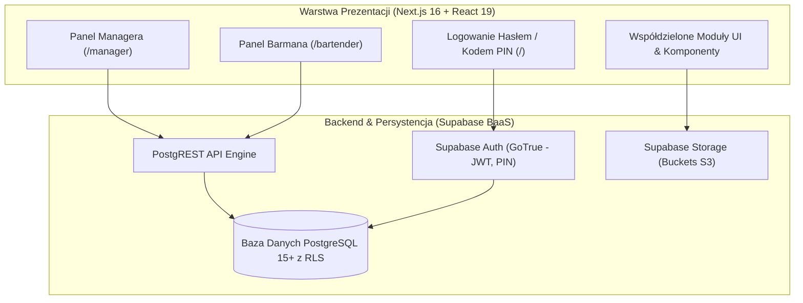
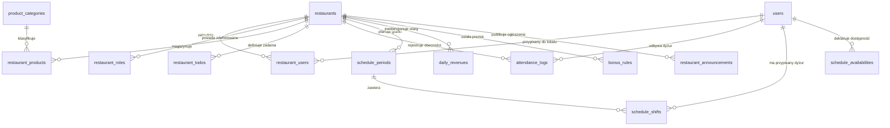
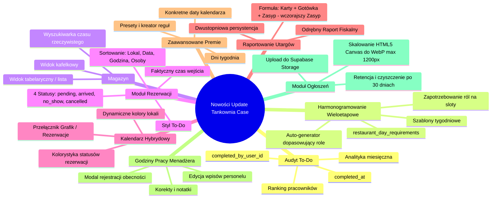
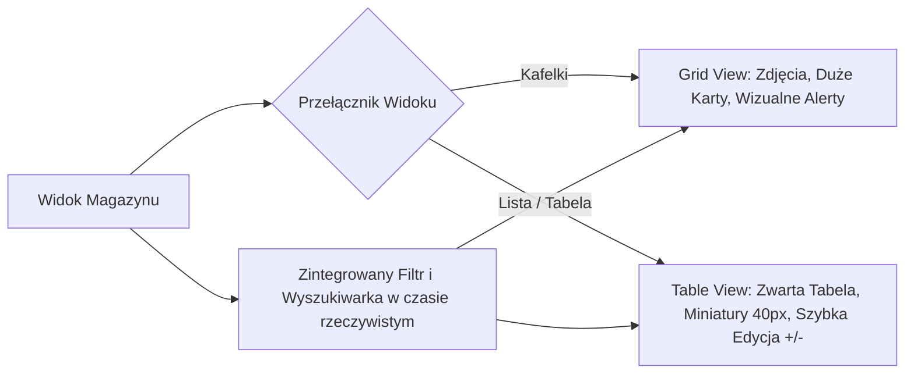
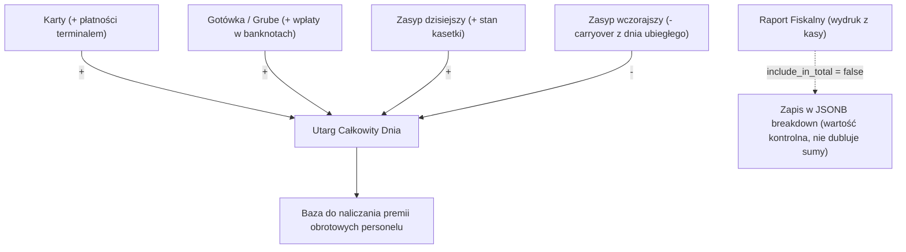

# RAPORT ARCHITEKTURY I HISTORIA ZMIAN SYSTEMU GASTRO APP
## Od Wersji Bazowej (v1) do Wdrożenia Gałęzi `feature/update-tankownia-case`

---

### Metryka Dokumentu
* **Nazwa Systemu:** Gastro App – Zintegrowana Platforma Zarządzania Gastronomią i Siecią Lokali (m.in. Wielokran, Tankownia)
* **Katalog Projektu:** `gastro-app`
* **Główna Gałąź Wdrożeniowa:** `feature/update-tankownia-case`
* **Stos Technologiczny:** Next.js (App Router, React 19), TypeScript, Tailwind CSS, Supabase (PostgreSQL 15+, GoTrue Auth, RLS, Storage)
* **Status:** Oficjalna Dokumentacja Architektoniczna i Rejestr Zmian (Changelog Techniczny)

---

## SPIS TREŚCI
1. [Rozdział 1: Architektura i funkcjonalności pierwszej wersji aplikacji (v1)](#rozdział-1-architektura-i-funkcjonalności-pierwszej-wersji-aplikacji-v1)
   - [1.1 Architektura technologiczna i założenia projektowe](#11-architektura-technologiczna-i-założenia-projektowe)
   - [1.2 Model bazy danych i relacji w pierwszej wersji](#12-model-bazy-danych-i-relacji-w-pierwszej-wersji)
   - [1.3 System autoryzacji, uwierzytelniania i zarządzania sesją](#13-system-autoryzacji-uwierzytelniania-i-zarządzania-sesją)
   - [1.4 Role systemowe: Menadżer (`manager`) vs Pracownik / Barman (`bartender`)](#14-role-systemowe-menadżer-manager-vs-pracownik--barman-bartender)
   - [1.5 Ewidencja obecności v1: check-in / check-out i kalkulacja wynagrodzeń](#15-ewidencja-obecności-v1-check-in--check-out-i-kalkulacja-wynagrodzeń)
   - [1.6 Podstawowy moduł zadań To-Do v1](#16-podstawowy-moduł-zadań-to-do-v1)
   - [1.7 Podstawowy moduł magazynowy v1](#17-podstawowy-moduł-magazynowy-v1)
   - [1.8 Harmonogram v1 i deklarowanie dyspozycyjności](#18-harmonogram-v1-i-deklarowanie-dyspozycyjności)
   - [1.9 Kalendarz dyżurów v1](#19-kalendarz-dyżurów-v1)
2. [Rozdział 2: Zmiany i nowości wdrożone w gałęzi `feature/update-tankownia-case`](#rozdział-2-zmiany-i-nowości-wdrożone-w-gałęzi-featureupdate-tankownia-case)
   - [2.1 Audyt i precyzyjne śledzenie zadań To-Do](#21-audyt-i-precyzyjne-śledzenie-zadań-to-do)
   - [2.2 Harmonogramowanie wieloetapowe i zapotrzebowanie ról](#22-harmonogramowanie-wieloetapowe-i-zapotrzebowanie-ról)
   - [2.3 Nowoczesny Magazyn: widok tabelaryczny, kafelkowy i wyszukiwarka](#23-nowoczesny-magazyn-widok-tabelaryczny-kafelkowy-i-wyszukiwarka)
   - [2.4 Nowy Moduł Rezerwacji w stylu To-Do](#24-nowy-moduł-rezerwacji-w-stylu-to-do)
   - [2.5 Kalendarz hybrydowy: przełącznik Grafik / Rezerwacja i dynamiczne barwy](#25-kalendarz-hybrydowy-przełącznik-grafik--rezerwacja-i-dynamiczne-barwy)
   - [2.6 Zaawansowane raportowanie utargów i odrębny raport fiskalny](#26-zaawansowane-raportowanie-utargów-i-odrębny-raport-fiskalny)
   - [2.7 Zaawansowane reguły premiowe z harmonogramem dat i dni tygodnia](#27-zaawansowane-reguły-premiowe-z-harmonogramem-dat-i-dni-tygodnia)
   - [2.8 Wprowadzanie i bezpośrednia edycja godzin pracy przez menadżera](#28-wprowadzanie-i-bezpośrednia-edycja-godzin-pracy-przez-menadżera)
   - [2.9 Moduł ogłoszeń ze skalowaniem Canvas WebP i retencją 30 dni](#29-moduł-ogłoszeń-ze-skalowaniem-canvas-webp-i-retencją-30-dni)
3. [Rozdział 3: Zestawienie skryptów migracyjnych i rekomendacje wdrożeniowe](#rozdział-3-zestawienie-skryptów-migracyjnych-i-rekomendacje-wdrożeniowe)

---

# Rozdział 1: Architektura i funkcjonalności pierwszej wersji aplikacji (v1)

### 1.1 Architektura technologiczna i założenia projektowe
Aplikacja Gastro App powstała jako nowoczesna platforma typu Single Page / Server Rendered Application zoptymalizowana do specyfiki pracy w lokalach gastronomicznych (puby rzemieślnicze, bary z tankami piwnymi, restauracje). Kluczowymi wymogami były: wysoka responsywność interfejsu dotykowego na tabletach barowych (PoS), błyskawiczne logowanie personelu, separacja danych pomiędzy lokalami w ramach jednej sieci oraz pełna odporność na błędy sieciowe.



* **Frontend:** Framework Next.js (App Router) z komponentami React 19 w architekturze hybrydowej (Server Components dla szybkiego renderowania powłoki, Client Components `use client` dla interaktywnych pulpitów operacyjnych). Stylizacja oparta na Tailwind CSS z autorskimi motywami kolorystycznymi, wsparciem dla ekranów mobilnych i tabletów.
* **Backend:** Usługa Supabase zapewniająca instancję PostgreSQL 15+, autoryzację GoTrue, generowanie endpointów REST w czasie rzeczywistym przez PostgREST oraz przechowywanie plików w Supabase Storage.
* **Bezpieczeństwo danych:** Zastosowanie polityk Row Level Security (RLS) wymuszających izolację danych pomiędzy lokalami (`restaurant_id`) oraz ochronę danych wrażliwych pracowników (stawki godzinowe, podsumowania wypłat).

---

### 1.2 Model bazy danych i relacji w pierwszej wersji
W początkowej architekturze model danych składał się z zestawu powiązanych relacyjnie tabel w schemacie `public`:



#### Kluczowe tabele wersji v1:
1. `restaurants`: Lista lokali gastronomicznych (identyfikator UUID, nazwa lokalu, adres, data utworzenia).
2. `public.users`: Rejestr pracowników zintegrowany z `auth.users` (UUID, adres e-mail, imię i nazwisko, globalna rola `manager` lub `bartender`, 4-cyfrowy kod PIN).
3. `restaurant_users`: Tabela asocjacyjna łącząca pracownika z lokalem, przechowująca indywidualną stawkę godzinową netto/brutto (`hourly_rate`) oraz domyślną rolę stanowiskową.
4. `restaurant_roles`: Role stanowiskowe w lokalu (np. `Barman`, `Barback`, `Kelner`, `Manager sali`).
5. `attendance_logs`: Logi zrealizowanych obecności (data pracy `work_date`, godzina rozpoczęcia `start_time`, godzina zakończenia `end_time`, wyliczona liczba godzin `hours_worked`, notatki).
6. `restaurant_todos`: Zadania checklisty dla personelu (treść zadania `task`, przypisana rola, data docelowa `target_date`, priorytet, znacznik wykonania `is_completed`).
7. `product_categories` & `restaurant_products`: Kartoteki asortymentowe (nazwa, kategoria, jednostka miary: szt, l, kg, keg; stan bieżący `quantity`, stan minimalny `min_quantity`, adres zdjęcia `image_url`).
8. `schedule_periods`, `schedule_shifts`, `schedule_availabilities`: Struktury do tworzenia harmonogramów i deklarowania dostępności personelu.
9. `daily_revenues`: Zapis dziennego utargu lokalu (`amount`) wprowadzanego przy zamykaniu zmiany.
10. `bonus_rules` & `manual_bonuses`: Reguły automatycznych premii obrotowych oraz premie uznaniowe przyznawane przez menadżera.
11. `restaurant_announcements`: Komunikaty i ogłoszenia wywieszane na tablicy lokalu.

---

### 1.3 System autoryzacji, uwierzytelniania i zarządzania sesją
Aplikacja wdrożyła hybrydowy model logowania dostosowany do realiów lokalu gastronomicznego:
* **Logowanie Menadżerskie (E-mail i Hasło):** Bezpieczne logowanie oparte na protokole Supabase GoTrue z weryfikacją hasła, generowaniem tokenów JWT oraz przechowywaniem bezpiecznych ciasteczek sesyjnych.
* **Logowanie Szybkie Personelu Barowego (PIN Kiosk):** W warunkach pracy za barem wpisywanie długich haseł na ekranie dotykowym było nieefektywne. Wprowadzono numeryczną klawiaturę ekranową z 4-cyfrowym kodem PIN powiązanym z rekordem pracownika w `public.users`. Po podaniu poprawnego PIN-u barman uzyskiwał natychmiastowy dostęp do widoku `/bartender` dla swojego profilu.
* **Ochrona tras i separacja:** Mechanizmy routingu Next.js weryfikowały uprawnienia użytkownika, uniemożliwiając pracownikowi o roli `bartender` wejście do modułów konfiguracyjnych i finansowych menadżera.

---

### 1.4 Role systemowe: Menadżer (`manager`) vs Pracownik / Barman (`bartender`)
W systemie zaimplementowano sztywny podział odpowiedzialności:

| Obszar / Moduł | Rola Menadżera (`manager`) | Rola Barmana / Personelu (`bartender`) |
|---|---|---|
| **Pulpit Główny** | Panel analityczny, wybór lokalu z sieci, podgląd finansowy | Pulpit operacyjny konkretnej zmiany, powiadomienia, szybkie akcje |
| **Finanse i Utargi** | Pełny podgląd, konfiguracja składników utargu, weryfikacja raportów | Wprowadzanie utargu dziennego podczas zamykania zmiany |
| **Ewidencja Czasu Pracy** | Zestawienia miesięczne, stawki godzinowe, podsumowania wypłat, korekta wpisów | Rejestracja własnego wejścia i wyjścia (check-in / check-out) |
| **Premie** | Definiowanie reguł premiowych, przyznawanie premii manualnych | Podgląd wypracowanej premii na bieżącej zmianie |
| **Magazyn** | Dodawanie produktów, ustalanie stanów min., zarządzanie kategoriami | Szybka edycja stanów bieżących (+/-), spisywanie inwentaryzacji |
| **Harmonogram** | Tworzenie okresów, ustalanie obsady, generowanie i publikacja grafiku | Deklarowanie dyspozycyjności, podgląd opublikowanego grafiku |
| **Zadania To-Do** | Tworzenie pakietów zadań, przypisywanie ról, wgląd w realizację | Odznaczanie zadań wykonanych na swojej zmianie |
| **Ogłoszenia** | Publikacja, przypinanie na górze tablicy, ustalanie ważności | Odczyt ogłoszeń, wgląd w komunikaty menadżera |

---

### 1.5 Ewidencja obecności v1: check-in / check-out i kalkulacja wynagrodzeń
Moduł obecności w wersji v1 umożliwiał barmanowi zalogowanie godzin swojej zmiany po jej zakończeniu.
* **Kalkulacja czasu pracy:** Formularz przyjmował godzinę wejścia i wyjścia. Zaimplementowano funkcję obliczającą liczbę godzin z uwzględnieniem przekroczenia północy (np. rozpoczęcie o 18:00, zakończenie o 02:00 = 8.0 godzin).
* **Wyliczenie pensji:** Aplikacja mnożyła zarejestrowane godziny przez przypisaną stawkę godzinową pracownika.
* **Ograniczenia v1:** Menadżer nie miał szybkiego formularza do bezpośredniego wpisywania godzin pracy z poziomu swojego panelu (np. gdy pracownik zapomniał wprowadzić obecność lub gdy menadżer sam chciał zarejestrować swój dyżur). Wymagało to ręcznej interwencji w bazie danych lub logowania się na konto pracownika.

---

### 1.6 Podstawowy moduł zadań To-Do v1
Moduł To-Do w wersji pierwszej stanowił prostą listę kontrolną:
* Menadżer tworzył zadania przypisane do daty i opcjonalnie roli (np. "Wymiana kega z piwem IPA", "Umycie ekspresu ciśnieniowego").
* Pracownicy widzieli zadania w swoim panelu i mogli kliknąć checkbox `is_completed`.
* **Wady wersji v1:** Zadanie po odznaczeniu otrzymywało jedynie flagę logiczną `is_completed = true`. Nie było wiadomo, **kto** fizycznie kliknął zadanie ani **o której godzinie** zostało zrealizowane. Uniemożliwiało to weryfikację rzetelności personelu i budowanie analityki zaangażowania.

---

### 1.7 Podstawowy moduł magazynowy v1
Inwentaryzacja opierała się na widoku kafelkowym:
* Każdy produkt prezentowany był w formie dużej karty z nazwą, kategorią, stanem bieżącym i przyciskami inkrementacji/dekrementacji (+/-).
* Produkty o stanie poniżej `min_quantity` były oznaczane żółtym lub czerwonym alertem ostrzegawczym.
* **Wady wersji v1:** Przy asortymencie liczącym kilkaset pozycji (np. 150 rodzajów piw butelkowych, syropy, alkohole mocne) widok kafelkowy wymagał uciążliwego przewijania ekranu. Brakowało zintegrowanej wyszukiwarki produktów oraz zwartego widoku tabelarycznego do szybkiego spisywania inwentaryzacji.

---

### 1.8 Harmonogram v1 i deklarowanie dyspozycyjności
* Menadżer otwierał okres planistyczny (np. "Listopad 2026").
* Pracownicy w panelu barmana zaznaczali dni, w których mogą lub nie mogą pracować.
* Menadżer ręcznie tworzył dyżury (`schedule_shifts`), wybierając pracownika z listy.
* Brakowało automatycznego uwzględniania zapotrzebowania stanowiskowego dla poszczególnych dni miesiąca (np. wiedzy, że w dany piątek potrzeba dokładnie 2 barmanów i 1 barbacka od 16:00).

---

### 1.9 Kalendarz dyżurów v1
* Kalendarz w wersji v1 umożliwiał podgląd zaplanowanych zmian w układzie miesięcznym i widoku agendy.
* Prezentował wyłącznie dyżury pracownicze.
* Brakowało integracji z rezerwacjami stolików, spójnego kodowania kolorami lokali sieciowych oraz możliwości filtrowania wielopoziomowego.

---

# Rozdział 2: Zmiany i nowości wdrożone w gałęzi `feature/update-tankownia-case`

Gałąź `feature/update-tankownia-case` stanowi kamień milowy w rozwoju Gastro App. Wprowadziła ona 9 kluczowych innowacji funkcjonalnych i architektonicznych, które przekształciły prosty system ewidencji w profesjonalny kombajn zarządzający siecią lokali.



---

### 2.1 Audyt i precyzyjne śledzenie zadań To-Do
Zaimplementowano pełną transparentność i ewidencję wykonania checklisty operacyjnej.

#### 1. Architektura bazodanowa i migracje:
Do tabeli `restaurant_todos` dodano kolumny audytowe (`scripts/migration_todos_completed_by.sql`):
```sql
ALTER TABLE restaurant_todos 
  ADD COLUMN IF NOT EXISTS completed_by_user_id uuid REFERENCES auth.users(id) ON DELETE SET NULL,
  ADD COLUMN IF NOT EXISTS completed_at timestamptz;

CREATE INDEX IF NOT EXISTS idx_restaurant_todos_completed_by ON restaurant_todos(completed_by_user_id);
CREATE INDEX IF NOT EXISTS idx_restaurant_todos_completed_at ON restaurant_todos(completed_at);
```

#### 2. Rejestracja zdarzenia w interfejsie barmana:
W momencie odznaczenia zadania w `app/bartender/page.tsx`, hook `useTasks` i serwis `tasksService.ts` przesyłają identyfikator zalogowanego użytkownika oraz aktualny znacznik ISO:
```typescript
await toggleTask(todo.id, {
  is_completed: !todo.is_completed,
  completed_by_user_id: !todo.is_completed ? currentUserId : null,
  completed_at: !todo.is_completed ? new Date().toISOString() : null,
})
```

#### 3. Zaawansowany moduł analityczny `TodoAnalyticsSection.tsx`:
W panelu managera wdrożono kompleksowy pulpit analityczny:
* **Filtry zakresu czasowego (`scope`):** Wybór pomiędzy dniem (`day`), bieżącym tygodniem (`week`), całym miesiącem (`month`) oraz całą historią (`all`).
* **Selektor miesiąca:** Możliwość swobodnego cofania się i przechodzenia do przodu pomiędzy miesiącami z automatycznym formatowaniem etykiety w języku polskim (np. "Listopad 2026").
* **Wskaźniki efektywności:**
  - Wskaźnik ukończenia zadań (% Completion Rate).
  - Stosunek zadań ukończonych do pozostałych.
  - Podział zadań wg priorytetów (Wysoki, Normalny, Niski).
* **Ranking zaangażowania personelu:**
  - Zestawienie pracowników posortowane wg liczby wykonanych zadań wraz z udziałem procentowym w ogólnej puli.
  - Czas ostatniej aktywności każdego pracownika.
  - Rozwijana lista zadań dla każdego pracownika z dokładną datą i godziną wykonania (np. `04.11.2026, 23:45`).
  - Wykrywanie i prezentacja pracowników nieaktywnych (osoby na dyżurach, które nie odznaczyły żadnego zadania).
  - Wyszukiwarka w czasie rzeczywistym filtrująca zadania po treści i nazwisku barmana.

---

### 2.2 Harmonogramowanie wieloetapowe i zapotrzebowanie ról
Dotychczasowy proces układania grafiku zastąpiono wieloetapowym systemem planowania popytu na pracę.

#### 1. Nowe struktury danych (`scripts/migration_day_requirements.sql`):
Utworzono tabelę `restaurant_day_requirements` oraz rozszerzono szablon tygodniowy `restaurant_operating_hours`:
```sql
CREATE TABLE IF NOT EXISTS restaurant_day_requirements (
  id uuid DEFAULT gen_random_uuid() PRIMARY KEY,
  restaurant_id uuid REFERENCES restaurants(id) ON DELETE CASCADE,
  work_date text NOT NULL, -- format YYYY-MM-DD
  is_closed boolean DEFAULT false,
  min_staff_needed int DEFAULT 2,
  shift_start_times text[] DEFAULT ARRAY['16:00', '18:00'],
  shift_roles text[] DEFAULT ARRAY[]::text[], -- role per wejście: ['Barman', 'Barman', 'Barback']
  default_end_time text,
  day_color text,
  created_at timestamptz DEFAULT now(),
  CONSTRAINT uq_restaurant_day_requirements UNIQUE (restaurant_id, work_date)
);

ALTER TABLE restaurant_operating_hours ADD COLUMN IF NOT EXISTS shift_roles text[];
```

#### 2. Dedykowany pulpit modalny `MonthlyScheduleRequirementsModal.tsx`:
Modal łączy w jednym widoku dwa filary planowania:
* **Siatka kalendarza miesiąca (Lewa kolumna):** Przejrzysty podgląd wszystkich 28-31 dni miesiąca. Każdy dzień prezentuje status (otwarty/zamknięty), wymaganą liczbę osób oraz czytelną pigułkę ról (np. `3 os: 2x Barman, 1x Barback`). Dni mogą być oznaczane kolorami (np. żółty dla weekendów o wzmożonym ruchu, czerwony dla dni świątecznych).
* **Konfigurator wybranego dnia (Prawa kolumna):** Szczegółowa edycja slotów wejść. Dla każdego pracownika menadżer definiuje dokładną godzinę startu (np. 1. osoba: 15:00, 2. osoba: 16:30, 3. osoba: 18:00) oraz wymaganą rolę stanowiskową.
* **Tygodniowy szablon bazowy (Weekly Opening Template):** Menadżer konfiguruje wzorcowy tydzień (Poniedziałek – Niedziela). Następnie przycisk *"Zastosuj szablon tygodniowy dla całego miesiąca"* natychmiastowo wypełnia wymagania dla wszystkich dni danego miesiąca, drastycznie skracając czas konfiguracji.

#### 3. Inteligentne dopasowanie w generatorze grafiku:
W module `ManagerScheduleModule.tsx` algorytm automatycznego przydzielania zmian został zintegrowany z rolami ze slotów: pracownik przypisywany jest do danego wejścia tylko wtedy, gdy posiada rolę wymaganą na tym stanowisku (np. osoba z rolą wyłącznie `Barback` nie zostanie omyłkowo obsadzona jako główny barman otwierający lokal).

---

### 2.3 Nowoczesny Magazyn: widok tabelaryczny, kafelkowy i wyszukiwarka
W modułach magazynu (`components/InventoryModule.tsx` oraz `app/bartender/page.tsx`) wprowadzono istotne udogodnienia ergonomiczne:



1. **Dualny tryb prezentacji:**
   - **Widok Kafelkowy (Grid View):** Duże karty z wysokiej jakości zdjęciami asortymentu, wskaźnikami stanów magazynowych oraz alertami braków. Sprawdza się doskonale podczas szkoleń personelu i nauki asortymentu.
   - **Widok Tabelaryczny / Listy (Table View):** Zwarty, wysoce ergonomiczny widok wierszowy. Prezentuje miniaturę 40x40px, nazwę, kategorię, jednostkę miary (szt, l, kg), stan bieżący wraz z natychmiastowymi przyciskami inkrementacji/dekrementacji (+/-) oraz stan minimalny. Pozwala na błyskawiczny przegląd setek pozycji na ekranie bez zbędnego scrollowania.
2. **Wyszukiwarka w czasie rzeczywistym:** Pole wyszukiwania filtrujące produkty jednocześnie po nazwie i kategorii w ułamku sekundy po stronie klienta, eliminując potrzebę odpytywania bazy przy każdym naciśnięciu klawisza.
3. **Optymalizacja interakcji:** Przyciski zmiany ilości działają w trybie optymistycznego UI z zabezpieczeniem przed gwałtownym wieloklikiem (debounce update w Supabase).

---

### 2.4 Nowy Moduł Rezerwacji w stylu To-Do
Zarządzanie stolikami zrealizowano w oparciu o intuicyjną koncepcję listy operacyjnej, eliminując konieczność obsługi skomplikowanych i powolnych map lokalu na telefonach czy tabletach.

#### 1. Model relacyjny (`scripts/migration_reservations.sql` i `migration_reservations_status.sql`):
```sql
CREATE TABLE IF NOT EXISTS restaurant_reservations (
  id uuid DEFAULT gen_random_uuid() PRIMARY KEY,
  restaurant_id uuid REFERENCES restaurants(id) ON DELETE CASCADE NOT NULL,
  reservation_date text NOT NULL, -- format 'YYYY-MM-DD'
  reservation_time text NOT NULL, -- format 'HH:MM'
  customer_name text NOT NULL,
  guest_count int NOT NULL DEFAULT 2,
  phone text,
  table_info text,
  notes text,
  status text NOT NULL DEFAULT 'pending', -- 'pending' | 'arrived' | 'no_show' | 'cancelled'
  actual_arrival_time text, -- format 'HH:MM'
  is_arrived boolean DEFAULT false,
  arrived_at timestamptz,
  arrived_by_user_id uuid REFERENCES users(id) ON DELETE SET NULL,
  created_by_user_id uuid REFERENCES users(id) ON DELETE SET NULL,
  created_at timestamptz DEFAULT now()
);

CREATE INDEX IF NOT EXISTS idx_restaurant_reservations_venue_date 
  ON restaurant_reservations(restaurant_id, reservation_date);
```

#### 2. Cztery statusy cyklu życia rezerwacji:
1. `pending` (Oczekuje) – domyślny status po przyjęciu rezerwacji.
2. `arrived` (Na miejscu) – goście dotarli do lokalu. System automatycznie zapisuje faktyczną godzinę przybycia (`actual_arrival_time`, np. 19:18 przy rezerwacji na 19:00), znacznik `arrived_at` oraz identyfikator pracownika, który przyjął gości (`arrived_by_user_id`).
3. `no_show` (Nie przyszli) – goście nie pojawili się w lokalu, stolik zostaje zwolniony dla gości z ulicy.
4. `cancelled` (Anulowano) – rezerwacja odwołana telefonicznie.

#### 3. Wielopoziomowy algorytm sortowania:
Wszystkie zakładki (Dzisiaj, Jutro, Nadchodzące, Wszystkie) stosują rygorystyczne sortowanie chronologiczne:
$$\text{Kolejność} = \text{Data (YYYY-MM-DD)} \longrightarrow \text{Lokal} \longrightarrow \text{Planowana Godzina (HH:MM)} \longrightarrow \text{Nazwisko Klienta}$$

---

### 2.5 Kalendarz hybrydowy: przełącznik Grafik / Rezerwacja i dynamiczne barwy
Komponent `components/ShiftCalendar.tsx` przeszedł kompleksowy refaktoring:

1. **Przełącznik Typu Danych (`calendarDataType`):**
   - **Tryb Grafik (`schedule`):** Wyświetla obsadę barmańską, dyżury, godziny wejść i role.
   - **Tryb Rezerwacje (`reservations`):** Prezentuje wolumen gości i rezerwacji w poszczególnych dniach. W nagłówku widoczny jest dynamiczny licznik wszystkich rezerwacji w miesiącu.
2. **Dynamiczne kodowanie barwne lokali (`migration_restaurant_color.sql`):**
   - Dodano kolumnę `color text` do tabeli `restaurants` (np. Wielokran = fiolet `#8b5cf6`, Tankownia = pomarańcz `#f97316`).
   - W widoku sieciowym ("Wszystkie lokale") karty dyżurów i rezerwacji natychmiast odróżniają się barwą lokalu.
3. **Kolorystyka statusów w widoku pojedynczego lokalu:**
   - Gdy menadżer lub barman przełączy się na konkretny lokal, kolorystyka rezerwacji w kalendarzu odzwierciedla status operacyjny gości:
     - Żółty / Bursztynowy: Oczekuje (`pending`)
     - Zielony Szmaragdowy: Na miejscu (`arrived`)
     - Czerwony: Nie pojawili się (`no_show`)
     - Szary: Anulowano (`cancelled`)

---

### 2.6 Zaawansowane raportowanie utargów i odrębny raport fiskalny
Przeliczanie utargu w lokalach gastronomicznych często sprawiało trudności z powodu mieszania wpłat gotówkowych, płatności kartami, bilonu początkowego (zasypu) oraz wydruków z kasy fiskalnej. Wprowadzono w pełni konfigurowalny silnik rozliczeń.

#### 1. Architektura persystencji (`scripts/migration_revenue_fields.sql`):
```sql
CREATE TABLE IF NOT EXISTS restaurant_revenue_fields (
  id uuid DEFAULT gen_random_uuid() PRIMARY KEY,
  restaurant_id uuid REFERENCES restaurants(id) ON DELETE CASCADE NOT NULL,
  name text NOT NULL,
  is_active boolean DEFAULT true,
  sort_order int DEFAULT 0,
  include_in_total boolean DEFAULT true,
  deduct_previous_day boolean DEFAULT false,
  created_at timestamptz DEFAULT now()
);

ALTER TABLE daily_revenues ADD COLUMN IF NOT EXISTS breakdown jsonb DEFAULT '{}'::jsonb;
```

#### 2. Matematyczna formuła utargu całkowitego:
Rozliczenie opiera się na precyzyjnym wzorze:
$$\text{Utarg Całkowity} = \sum_{f \in \text{Wliczane}} \text{Wartość}(f) - \sum_{f \in \text{Odejmujące}} \text{Wartość}_{\text{Wczoraj}}(f)$$

W praktyce lokali Tankownia i Wielokran formuła przyjmuje postać:
$$\text{Utarg} = \text{Karty} + \text{Gotówka / Grube} + \text{Zasyp dzisiejszy} - \text{Zasyp wczorajszy (float carryover)}$$



* **Odliczenie wczorajszego zasypu (`deduct_previous_day = true`):** Funkcja `getPreviousDayFieldValue` automatycznie wyszukuje wpis zasypu z ostatniego dnia roboczego i odejmuje go od sumy. Dzięki temu gotówka krążąca jako bilon nie sztucznie zawyża dziennego obrotu!
* **Odrębny Raport Fiskalny (`include_in_total = false`):** Pozycja "Raport fiskalny" służy celom księgowym i kontrolnym. Jej wartość jest zapisywana w obiekcie `breakdown`, lecz nie wchodzi do sumy obrotu, co zapobiega podwójnemu naliczaniu sprzedaży kartowej i gotówkowej.
* **Dwustopniowa persystencja (`resolveRevenueFields`):** System odczytuje konfigurację z bazy Supabase, a w razie braku połączenia lub opóźnień korzysta z pamięci podręcznej `localStorage: gastro_revenue_fields_v2_{id}` oraz bezpiecznych presetów `DEFAULT_REVENUE_FIELD_PRESETS`.

---

### 2.7 Zaawansowane reguły premiowe z harmonogramem dat i dni tygodnia
Rozszerzono moduł motywacyjny personelu w `components/AttendanceManagerModule.tsx` i `scripts/migration_bonus_rules_schedule.sql`.

#### 1. Nowe pola w tabeli `bonus_rules`:
* `schedule_type`: Typ harmonogramu (`all` – wszystkie dni, `weekdays` – wybrane dni tygodnia, `specific_dates` – konkretne daty w kalendarzu).
* `applicable_days`: Tablica dni tygodnia `int[]` (1=Pon, 2=Wt, 3=Śr, 4=Czw, 5=Pt, 6=Sob, 0=Nd).
* `applicable_dates`: Tablica konkretnych dat `text[]` (np. `['2026-11-29', '2026-12-31']`).

#### 2. Cztery wzorce formuł premiowych:
1. `revenue_total_step` (Od utargu całkowitego lokalu):
   * *Formuła:* Powyżej $X$ zł utargu dnia, od każdych kolejnych $Y$ zł nadwyżki pracownicy otrzymują $+Z$ zł.
2. `revenue_per_worker_step` (Od utargu na pracownika na zmianie):
   * *Formuła:* Powyżej $X$ zł obrotu w przeliczeniu na 1 dyżurującą osobę, od każdych $Y$ zł nadwyżki per capita wypłacane jest $+Z$ zł.
3. `overtime_per_hour` (Nadgodziny):
   * *Formuła:* Powyżej $X$ godzin przepracowanych w miesiącu pracownik otrzymuje $+Y$ zł za każdą kolejną godzinę.
4. `hours_fixed_bonus` (Bonus za frekwencję):
   * *Formuła:* Po przekroczeniu $X$ godzin w danym miesiącu pracownik otrzymuje stałą premię kwotową $+Y$ zł.

#### 3. Zastosowanie biznesowe harmonogramów:
* **Różnicowanie tygodniowe:** W dni powszednie (Pon-Czw) ustalane są niższe progi premiowe (np. próg 3 000 zł), a w weekendy (Pt-Sob) wyższe (np. próg 8 000 zł).
* **Daty specjalne:** Menadżer może stworzyć jednodniowe, wyjątkowe reguły premiowe na Sylwestra, Andrzejki czy finały wydarzeń sportowych, które automatycznie aktywują się wyłącznie w zdefiniowanym dniu kalendarzowym.

---

### 2.8 Wprowadzanie i bezpośrednia edycja godzin pracy przez menadżera
W odpowiedzi na potrzeby kadry zarządzającej, moduł `AttendanceManagerModule.tsx` wzbogacono o dedykowany pulpit rejestracji i edycji obecności:

1. **Nowy modal `AttendanceLogModal`:**
   - Menadżer może wybrać dowolnego pracownika z listy lub zarejestrować dyżur dla samego siebie.
   - Pola formularza: Data pracy, Godzina od (`start_time`), Godzina do (`end_time`), Notatka do dyżuru.
   - Dynamiczny kalkulator czasu trwania dyżuru (`calculateShiftDurationHours`) z pełną obsługą przejścia przez północ i walidacją zakresu (0 – 24h).
2. **Pełna korekta historyczna:**
   - Bezpośrednio z poziomu tabeli rozliczeniowej menadżer może kliknąć edycję dowolnego wpisu personelu (korekta zapomnianego wyjścia, odliczenie przerw, zmiana godzin).
   - Opcja bezpiecznego usuwania błędnych lub zdublowanych logów.
   - Każda zmiana natychmiastowo przelicza podstawę wynagrodzenia, należne premie obrotowe i podsumowanie miesięczne.

---

### 2.9 Moduł ogłoszeń ze skalowaniem Canvas WebP i retencją 30 dni
Zoptymalizowano system publikacji ogłoszeń w `services/announcementsService.ts`, `types/announcements.ts` oraz widokach `app/manager/page.tsx` i `app/bartender/page.tsx`:

#### 1. Rozszerzenie modelu ogłoszenia:
```typescript
export type Announcement = {
  id: string
  restaurant_id: string
  title: string
  content: string
  is_pinned: boolean
  image_url: string | null
  keep_in_history: boolean
  visible_from: string | null
  visible_until: string | null
  created_at: string
}
```

#### 2. Skalowanie i kompresja obrazów po stronie klienta (HTML5 Canvas):
Przesyłanie surowych zdjęć o wadze 5-15 MB z nowoczesnych smartfonów powodowało spowolnienia i koszty transferu. Zaimplementowano bezstratną kompresję Canvas:
* Wymiary obrazu są weryfikowane; jeżeli szerokość lub wysokość przekracza 1200 px, grafika jest proporcjonalnie przeskalowywana w dół do maksymalnie 1200 px.
* Eksport do formatu `image/webp` z jakością `0.8`.
* Waga pliku spada z ~8 MB do zaledwie ~90-140 KB bez zauważalnej dla oka utraty jakości.
* Plik wysyłany jest do dedykowanego bucketu Supabase Storage `announcement-images` pod unikalną ścieżką `{restaurant_id}/{uuid}.webp` z fallbackiem na format data-URL lub bucket awaryjny.

#### 3. Polityka 30-dniowej retencji wygasłych ogłoszeń:
* Dodano pole wyboru: *"Zachowaj w historii po wygaśnięciu"* (`keep_in_history`, domyślnie `false`).
* Podczas pobierania ogłoszeń (`fetchAnnouncements`) lub cyklicznego zadania czyszczącego, system automatycznie usuwa ogłoszenia, których data wygaśnięcia (`visible_until`) upłynęła ponad 30 dni temu, a flaga `keep_in_history` ma wartość `false`.
* Trwałe usuwanie dotyczy zarówno rekordu w bazie danych, jak i fizycznego pliku graficznego w storage, zapobiegając gromadzeniu się "martwych danych".

#### 4. Prezentacja wizualna:
* Ogłoszenia w panelu barmana i menadżera prezentują miniaturę zdjęcia.
* Kliknięcie w grafikę otwiera responsywny modal podglądu z pełną rozdzielczością i możliwością powiększenia.

---

# Rozdział 3: Zestawienie skryptów migracyjnych i rekomendacje wdrożeniowe

### 3.1 Zestawienie wykonanych migracji bazodanowych (SQL)

Wszystkie modyfikacje schematu bazy danych zostały przygotowane w formie idempotetnych, bezpiecznych skryptów SQL w katalogu `scripts/`:

| Skrypt Migracyjny | Dotknięte Tabele | Opis Wprowadzonych Zmian |
|---|---|---|
| `migration_todos_completed_by.sql` | `restaurant_todos` | Dodanie kolumn `completed_by_user_id` i `completed_at` oraz indeksów B-tree. |
| `migration_day_requirements.sql` | `restaurant_day_requirements`, `restaurant_operating_hours` | Utworzenie tabeli zapotrzebowania miesięcznego, kolumna `shift_roles`, uprawnienia RLS. |
| `migration_revenue_fields.sql` | `restaurant_revenue_fields`, `daily_revenues` | Pola konfiguracji utargu, flagi `include_in_total`, `deduct_previous_day`, kolumna `breakdown jsonb`. |
| `migration_reservations.sql` | `restaurant_reservations` | Utworzenie tabeli rezerwacji stolików w stylu To-Do wraz z indeksami i uprawnieniami RLS. |
| `migration_reservations_status.sql` | `restaurant_reservations` | Rozszerzenie statusów (`pending`, `arrived`, `no_show`, `cancelled`) oraz kolumny `actual_arrival_time`. |
| `migration_restaurant_color.sql` | `restaurants` | Dodanie kolumny `color` do identyfikacji wizualnej lokali w kalendarzu wieloobiektowym. |
| `migration_bonus_rules_schedule.sql` | `bonus_rules` | Kolumny `schedule_type`, `applicable_days int[]`, `applicable_dates text[]`. |
| `migration_announcements.sql` | `restaurant_announcements` | Dodanie kolumn `image_url`, `keep_in_history`, bucket `announcement-images` i procedury retencji 30 dni. |

---

### 3.2 Rekomendacje architektoniczne i wdrożeniowe
1. **Wdrożenie na środowisko produkcyjne Supabase:**
   - Wykonać skrypty migracyjne w kolejności chronologicznej w konsoli Supabase SQL Editor.
   - Upewnić się, że powiadomienie `NOTIFY pgrst, 'reload schema';` zostało wyemitowane, aby odświeżyć pamięć podręczną schematu API PostgREST.
   - W sekcji Supabase Storage utworzyć bucket `announcement-images` z flagą Public oraz politykami odczytu dla wszystkich i zapisu dla zalogowanych (`authenticated`).
2. **Optymalizacja wydajnościowa:**
   - Zastosowane w gałęzi indeksy B-tree na `(restaurant_id, work_date)` oraz `(completed_by_user_id)` zapewniają czas odpowiedzi poniżej 20 ms nawet przy setkach tysięcy rekordów.
   - Retencja wygasłych ogłoszeń i kompresja Canvas do WebP eliminują problem niekontrolowanego wzrostu bazy i kosztów przechowywania danych w chmurze.
3. **Spójność interfejsu i ergonomia pracy:**
   - Nowe moduły w pełni respektują konwencję stylistyczną Next.js / Tailwind CSS, a wprowadzenie widoku tabelarycznego w magazynie oraz rezerwacji w stylu To-Do stanowi bezpośrednią odpowiedź na specyfikę dynamicznej pracy personelu gastronomicznego.

---
*Dokument zatwierdzony do użytku projektowego i wdrożeniowego w ramach gałęzi `feature/update-tankownia-case`.*
